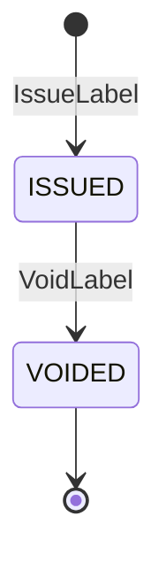
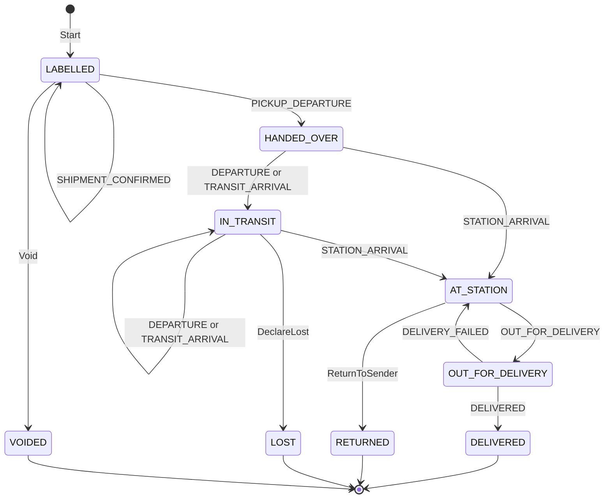

# Aggregate design canvas

Following the ddd-crew [Aggregate Design Canvas v1.1](https://github.com/ddd-crew/aggregate-design-canvas). The context has two aggregate roots, **ShippingLabel** and **PackageJourney** ([ADR 0002](/docs/adr/0002-aggregates-and-invariants)). They share the tracking number as a value, never as a reference: a label can be voided without a journey in memory, and the journey takes a scan per event without touching the label row or the encrypted address (the use case loads both only for `VoidLabel`).

## ShippingLabel

### 1. Name

`ShippingLabel` in `internal/domain/label`, identified by `labelRef` (`label.Ref`).

### 2. Description

The label for one package: tracking number, service tier, carrier, the opaque `stopKey` and the postal prefix. The address itself is not a field; the AES-256-GCM sealed snapshot lives behind the `ShipToSnapshots` port. The address is read once, at issue time, from customer-ordering (`GetShipTo`) and never published.

### 3. State transitions

Source: `internal/domain/label/label.go` (`Issue`, `Void`). `VOIDED` has no outgoing transition. A repeated void is answered by the use case with the unchanged label before the aggregate is reached; at the aggregate it would be `ErrIllegalTransition`.

### 4. Enforced invariants

| Invariant | Enforced by |
| --- | --- |
| One label per `(poNumber, packageNo)` | `label.ErrLabelAlreadyIssued`, unique index `shipping_labels_package_key`, pre-check `FindByPackage` |
| `trackingNumber` is unique | `label.ErrTrackingNumberTaken`, unique index `shipping_labels_tracking_key`; one retry with a fresh number |
| Ids are 1 to 64 characters, `packageNo` is 1 to 2147483647, `tier` is one of four | `checkNew` (`shared.ErrValidation`) |
| The carrier follows the tier | `label.CarrierFor`, checked again by `Restore` |
| `stopKey` is 64 lower-case hex characters, the postal prefix 1 to 16 characters from `A-Z0-9` | `checkDerived` |
| Void reason is 1 to 500 characters, trimmed | `shared.ValidTextN` |
| The ship-to address is never published | By construction: no event `data`, response schema or read model has an address field (`TestContractsCarryNoShipToField`) |

### 5. Corrective policies

- No policy of this context reacts to a label.
- Neighbour reactions to `LabelIssued`: linehaul-transportation adds the package to its expected-volume view, customer-ordering to its order-tracking view, last-mile-delivery groups stops by `stopKey` (per the AsyncAPI).
- `LabelVoided` is consumed by customer-ordering and linehaul-transportation per the AsyncAPI.

### 6. Handled commands

| Command | Issued by | Inbound adapter |
| --- | --- | --- |
| `IssueLabel` | vendor-connectivity, inside a vendor's label request | REST `POST /labels` |
| `VoidLabel` | No caller named | REST `POST /labels/{labelRef}:void` |

### 7. Created events

| Event | Raised when | Full CloudEvents type |
| --- | --- | --- |
| `LabelIssued` | `Issue` saves an `ISSUED` label | `com.retailnetwork.logistics.shipping-and-tracking.label.LabelIssued` |
| `LabelVoided` | `Void` moves the label to `VOIDED` | `com.retailnetwork.logistics.shipping-and-tracking.label.LabelVoided` |

Subject and Kafka key: `labelRef`.

### 8. Throughput

One write per package at issue, rarely a second at void. The only contention is a retried label request for the same `(poNumber, packageNo)`, resolved by the unique index and the `Idempotency-Key`. No load figure is measured in this repository.

### 9. Size

One `shipping_labels` row plus one `ship_to_snapshots` row. At most two events in its life.

## PackageJourney

### 1. Name

`PackageJourney` is the Go type `journey.Journey` in `internal/domain/journey`, identified by `trackingNumber`.

### 2. Description

The customer-visible timeline of one package. It owns its `Scan` entities (`ID`, `NodeID`, `Type`, `At`, `Applied`) and folds facts from three producers into one forward-only state: the vendor's shipment confirmation and the first pickup scan, linehaul load departures and arrivals, and last-mile out-for-delivery, attempt and return facts. It ends in `DELIVERED`, `RETURNED`, `LOST` or `VOIDED`.

### 3. State transitions

Source: `internal/domain/journey/types.go` (`next`, the single edge table), `internal/domain/journey/journey.go` (`Start`, `RecordScan`, `ReturnToSender`, `DeclareLost`, `Void`). `RaiseException` records a `NO_SCAN` exception in any open state without a transition and is not drawn. A scan with no edge from the state it meets, or older than the last applied scan, is stored with `applied=false` and does not move the state.

**Which fact drives which scan.** `internal/adapters/inbound/kafka/handlers.go` maps each consumed event:

| Source fact | Scan type | State before | State after | Note |
| --- | --- | --- | --- | --- |
| `VendorShipmentConfirmed` (per tracking number) | `SHIPMENT_CONFIRMED` | `LABELLED` | `LABELLED` | Applied: raises `PackageScanned`, but is not the handover |
| `LoadDeparted`, `departureKind` `PICKUP` (or absent while `LABELLED`) | `PICKUP_DEPARTURE` | `LABELLED` | `HANDED_OVER` | Raises `PackageHandedOver` with `handedOverAt` and the origin node |
| `LoadDeparted`, other kinds | `DEPARTURE` | `HANDED_OVER` or `IN_TRANSIT` | `IN_TRANSIT` | |
| `LoadArrived`, `nodeType` other than `DELIVERY_STATION` | `TRANSIT_ARRIVAL` | `HANDED_OVER` or `IN_TRANSIT` | `IN_TRANSIT` | |
| `LoadArrived`, `nodeType` `DELIVERY_STATION` | `STATION_ARRIVAL` | `HANDED_OVER` or `IN_TRANSIT` | `AT_STATION` | `HANDED_OVER` to `AT_STATION` is direct injection |
| `PackageOutForDelivery` | `OUT_FOR_DELIVERY` | `AT_STATION` | `OUT_FOR_DELIVERY` | Node is `stationNodeId` |
| `DeliveryAttempted`, outcome `DELIVERED` | `DELIVERED` | `OUT_FOR_DELIVERY` | `DELIVERED` | Raises `PackageDelivered`, closes the journey |
| `DeliveryAttempted`, other outcome | `DELIVERY_FAILED` | `OUT_FOR_DELIVERY` | `AT_STATION` | Back to the station for the next wave |
| `PackageReturnInitiated` | none (`ReturnToSender`) | `AT_STATION` | `RETURNED` | Raises `PackageReturned` |
| REST `POST /journeys/{trackingNumber}/scans` | the caller's `scanType` | per the edges | per the edges | No caller named |

Every applied scan raises `PackageScanned` with the new `state`.

### 4. Enforced invariants

| Invariant | Enforced by |
| --- | --- |
| A `scanId` is applied once; nothing is stored for a repeat | `journey.ErrDuplicateScan`, unique `(tracking_number, scan_id)` |
| Scans apply in time order; an older one is stored but does not move the state | `journey.ErrScanOutOfOrder` |
| `DELIVERED`, `RETURNED`, `LOST` and `VOIDED` are terminal | `journey.ErrJourneyClosed` |
| Only the edges of `next` exist (forward only); a scan with no edge from the current state is stored unapplied | `shared.ErrIllegalTransition` |
| A label can be voided only while the journey is `LABELLED` | `journey.ErrVoidAfterHandover` |
| Scan id 1 to 256 characters, node id 1 to 64, known scan type, `at` required | `ScanInput.validate` |
| Concurrent writers: the stored version must be the aggregate's version minus one | `ports.ErrConcurrentUpdate` |

### 5. Corrective policies

- **Handover on first scan** (this context): the first pickup departure scan at the vendor node sets `handedOverAt`, the instant node-performance scores vendors against.
- **Exception on silence** (this context): no applied scan within the window of the state and tier raises `PackageExceptionRaised`, reason `NO_SCAN`; windows are 6, 24, 48 and 72 hours for `SAME_DAY`, `NEXT_DAY`, `TWO_DAY` and `STANDARD`, 12 hours while out for delivery (`journey.SilenceWindow`). One exception per silence; a new applied scan re-arms it.
- **Lost after an unanswered exception** (this context): 48 hours after a `NO_SCAN` exception on an `IN_TRANSIT` journey with no applied scan since, `DeclareLost` runs.
- **Reactions elsewhere** (per the AsyncAPI): delivery-promise re-promises on `PackageExceptionRaised`, judges on `PackageDelivered`, and judges broken on `PackageReturned` and `PackageLost`; order-sourcing marks the assignment delivered on `PackageDelivered`.

### 6. Handled commands

| Command | Issued by | Inbound adapter |
| --- | --- | --- |
| `Start` | the `IssueLabel` use case, in the same transaction as the label | none of its own |
| `RecordScan` | the Kafka consumers of five event types; an unnamed REST caller | `internal/adapters/inbound/kafka`; REST `POST /journeys/{trackingNumber}/scans` |
| `RaiseException` | the `silence-sweep` job | `internal/scheduler` |
| `ReturnToSender` | the consumer of `PackageReturnInitiated` | `internal/adapters/inbound/kafka` |
| `DeclareLost` | the `silence-sweep` job | `internal/scheduler` |
| `Void` | the `VoidLabel` use case | REST `POST /labels/{labelRef}:void` |

### 7. Created events

| Event | Raised when | Full CloudEvents type |
| --- | --- | --- |
| `PackageScanned` | every applied scan | `com.retailnetwork.logistics.shipping-and-tracking.journey.PackageScanned` |
| `PackageHandedOver` | `LABELLED` to `HANDED_OVER` | `...journey.PackageHandedOver` |
| `PackageDelivered` | `OUT_FOR_DELIVERY` to `DELIVERED` | `...journey.PackageDelivered` |
| `PackageExceptionRaised` | `RaiseException`, no transition | `...journey.PackageExceptionRaised` |
| `PackageReturned` | `AT_STATION` to `RETURNED` | `...journey.PackageReturned` |
| `PackageLost` | `IN_TRANSIT` to `LOST` | `...journey.PackageLost` |

Subject and Kafka key: `trackingNumber`. `Start` and `Void` raise no journey event: `LabelIssued` and `LabelVoided` announce them. A handover or delivery raises two events in one transaction: `PackageScanned` and the milestone event.

### 8. Throughput

Every scan is a write, from four topics keyed by different ids, so two consumers can write the same journey at once. The `version` column is the optimistic lock and `usecases.transact` reruns the whole unit up to three times on `ErrConcurrentUpdate` (`maxAttempts` in `writer.go`) before the conflict surfaces. One load event names many tracking numbers and becomes one unit of work per journey. No load figure is measured in this repository.

### 9. Size

One `package_journeys` row plus its append-only `journey_scans` rows, every scan kept including unapplied ones. Events per journey: one `PackageScanned` per applied scan, one `PackageHandedOver`, one terminal event and zero or more `PackageExceptionRaised`.

## Read models

| Read model | Source events | Used for | Why it is not an aggregate |
| --- | --- | --- | --- |
| `catalog_dimensions` (`ports.CatalogDimensionsView`) | offer-availability `CatalogItemCreated` (`catalogItemId`, `title`, `lengthMm`, `widthMm`, `heightMm`, `weightG`, `hazmat`, `fragile`) | Item dimensions, weight and handling flags | It enforces no invariant and accepts no command: a local copy of another context's facts, rebuilt by replaying the topic. No use case of this repository reads it back yet |

`GET /journeys/{trackingNumber}` reads the `PackageJourney` itself through `views.Journey`; it is a query, not a separate read model.
