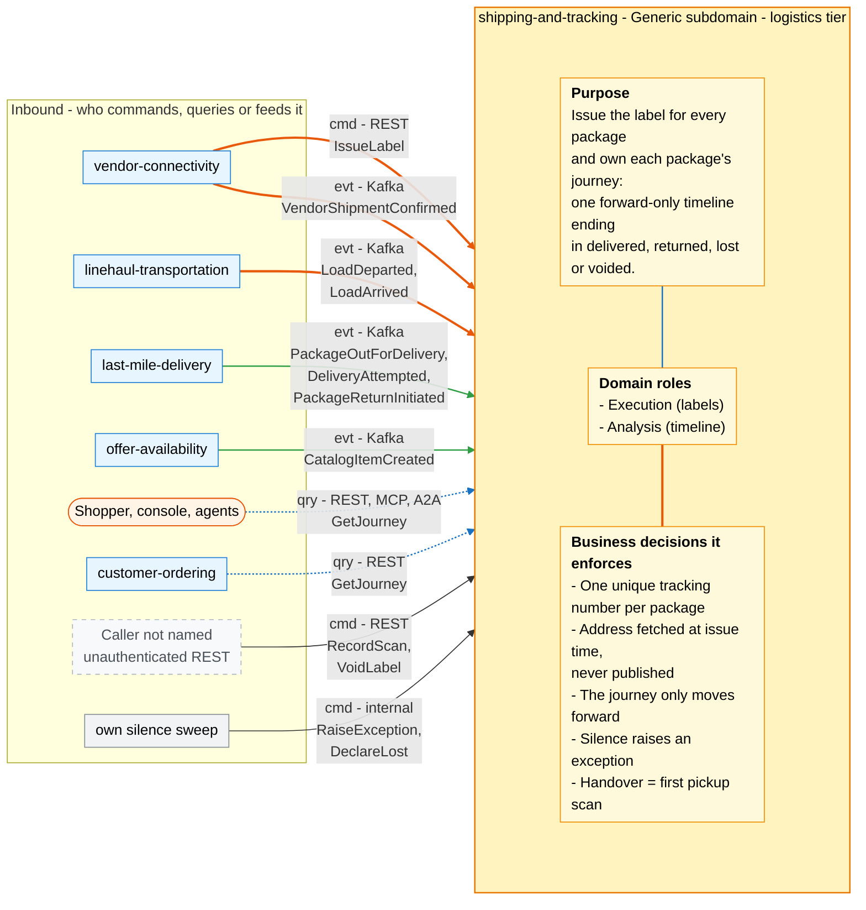
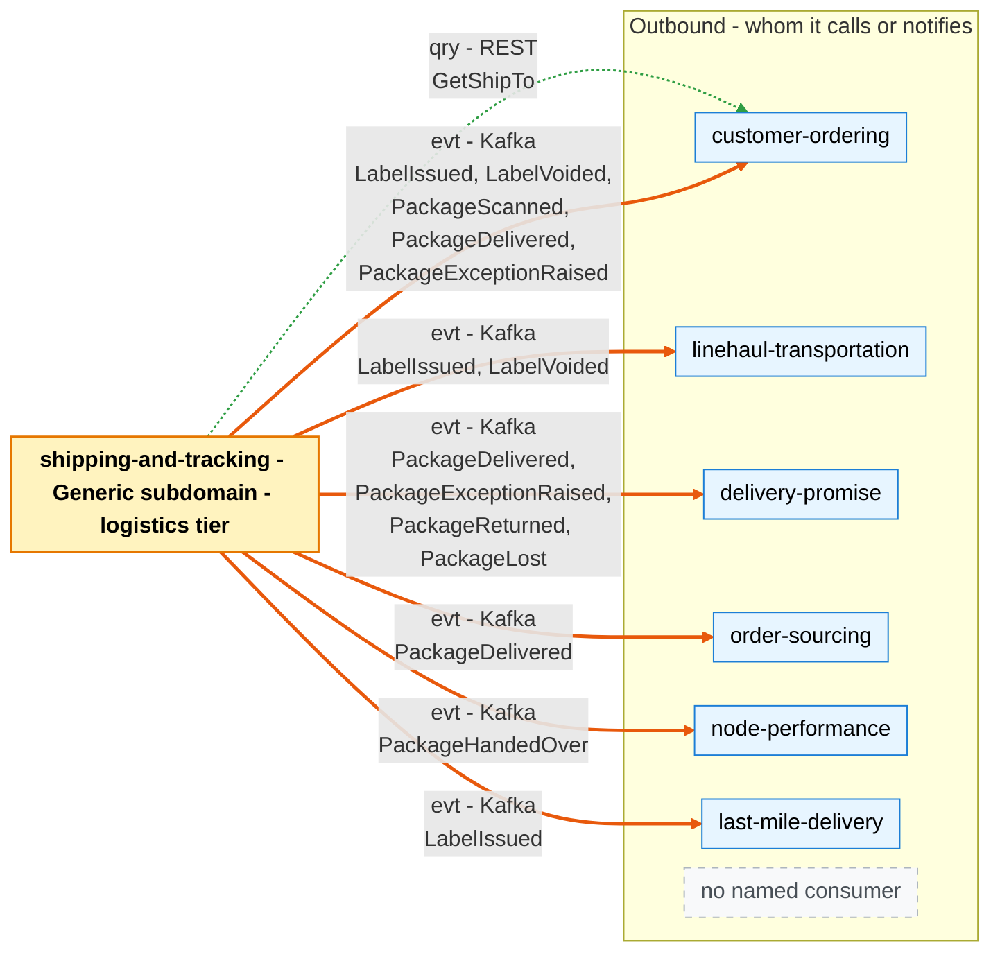

# Bounded context canvas

Following the ddd-crew [Bounded Context Canvas v5](https://github.com/ddd-crew/bounded-context-canvas). Every message row below maps to a route in `apis/openapi.yaml`, an event in `apis/asyncapi.yaml` or a consumer in `internal/adapters/inbound/kafka/handlers.go`.

## Canvas at a glance

Arrows follow the message type: solid blue commands (`cmd`), dotted green queries (`qry`), thick orange events (`evt`). The Inbound and Outbound Communication tables carry the exact route, topic and CloudEvents type for every message.

### Inbound

Source: `internal/adapters/inbound/http/server.go` (routes), `internal/adapters/inbound/kafka/handlers.go` (consumers), `internal/scheduler/scheduler.go` and `internal/application/usecases/sweep.go` (silence sweep).

### Outbound

Source: `internal/adapters/outbound/customerordering/gateway.go`, `internal/adapters/outbound/kafka/encoder.go`, and the consumer lists in `apis/asyncapi.yaml`. The diagram omits the synchronous reply `POST /labels` returns to vendor-connectivity. `PackageScanned` has no named consumer beyond customer-ordering's tracking view. All Kafka topics are `retailnetwork.<producer>.events`.

## Name

**Shipping & Tracking** (`shipping-and-tracking`, CloudEvents tier `logistics`).

## Purpose

To issue the shipping label for every package and to own each package's journey. The context:

- issues a label with a network-wide unique tracking number when vendor-connectivity asks for one in-organisation;
- reads the ship-to address from customer-ordering at that moment and keeps only an AES-256-GCM encrypted snapshot needed to print it;
- consolidates the vendor's shipment confirmation, the pickup scan, linehaul load departures and arrivals, and last-mile out-for-delivery, attempt and return facts into one customer-visible, forward-only timeline;
- ends that timeline in delivered, returned, lost or voided, and raises an exception when a package goes silent.

It is the only context outside customer-ordering that ever sees a ship-to address, and it publishes none.

## Strategic classification

| Axis | Verdict |
| --- | --- |
| Domain | **Generic subdomain**. See [Core domain chart](/docs/ddd/core-domain-chart) |
| Business model | Compliance and experience (labels and the tracking timeline) |
| Evolution | **Commodity**: a candidate to buy rather than build, behind an anti-corruption layer that keeps the published event names |

## Domain roles

| Role | Applies? | Evidence |
| --- | --- | --- |
| Execution (labels) | Yes | `ShippingLabel` with `IssueLabel` and `VoidLabel`; uniqueness of `(poNumber, packageNo)` and of `trackingNumber` |
| Analysis (timeline) | Yes | `PackageJourney` turns six foreign event types into one state machine; the handover instant and the silence policy derive facts nobody else publishes |
| Gateway | No | It guards personal data but translates no external model. The vendor reaches it only through vendor-connectivity |
| Specification | No | It declares nothing other contexts plan against |

## Inbound communication

| Collaborator | Message | Type | Channel | Relationship |
| --- | --- | --- | --- | --- |
| vendor-connectivity | `IssueLabel` | Command | REST `POST /labels` | Customer/Supplier (vendor-connectivity is the customer) |
| vendor-connectivity | `VendorShipmentConfirmed` | Event | Kafka `retailnetwork.vendor-connectivity.events`, `com.retailnetwork.partner.vendor-connectivity.purchaseorder.VendorShipmentConfirmed` | Conformist |
| linehaul-transportation | `LoadDeparted` | Event | Kafka `retailnetwork.linehaul-transportation.events`, `com.retailnetwork.logistics.linehaul-transportation.load.LoadDeparted` | Conformist |
| linehaul-transportation | `LoadArrived` | Event | same topic, `...load.LoadArrived` | Conformist |
| last-mile-delivery | `PackageOutForDelivery` | Event | Kafka `retailnetwork.last-mile-delivery.events`, `com.retailnetwork.logistics.last-mile-delivery.route.PackageOutForDelivery` | Conformist |
| last-mile-delivery | `DeliveryAttempted` | Event | same topic, `...route.DeliveryAttempted` | Conformist |
| last-mile-delivery | `PackageReturnInitiated` | Event | same topic, `...packageattempthistory.PackageReturnInitiated` (the `route` spelling is accepted) | Conformist |
| offer-availability | `CatalogItemCreated` | Event | Kafka `retailnetwork.offer-availability.events`, `com.retailnetwork.commerce.offer-availability.catalogitem.CatalogItemCreated` | Conformist |
| Shoppers, customer-ordering, console, agents | `GetJourney` | Query | REST `GET /journeys/{trackingNumber}`, MCP and A2A `get_journey` | Open host |
| Not named | `RecordScan` | Command | REST `POST /journeys/{trackingNumber}/scans` | No named caller |
| Not named | `VoidLabel` | Command | REST `POST /labels/{labelRef}:void` | No named caller |
| Itself | `RaiseException`, `DeclareLost` | Command | the `silence-sweep` job | Internal |

## Outbound communication

| Collaborator | Message | Type | Channel | Relationship |
| --- | --- | --- | --- | --- |
| customer-ordering | `GetShipTo` | Query (synchronous) | REST `GET {CUSTOMER_ORDERING_URL}/orders/{orderId}/ship-to` | Customer/Supplier (this context is the customer) |
| linehaul-transportation, customer-ordering, last-mile-delivery | `LabelIssued` | Event | Kafka `retailnetwork.shipping-and-tracking.events`, `com.retailnetwork.logistics.shipping-and-tracking.label.LabelIssued` | Published language |
| customer-ordering, linehaul-transportation | `LabelVoided` | Event | same topic, `...label.LabelVoided` | Published language |
| none named beyond customer-ordering's tracking view | `PackageScanned` | Event | same topic, `...journey.PackageScanned` | Published language |
| node-performance | `PackageHandedOver` | Event | same topic, `...journey.PackageHandedOver` | Published language |
| delivery-promise, order-sourcing, customer-ordering | `PackageDelivered` | Event | same topic, `...journey.PackageDelivered` | Published language |
| delivery-promise, customer-ordering | `PackageExceptionRaised` | Event | same topic, `...journey.PackageExceptionRaised` | Published language |
| delivery-promise | `PackageReturned` | Event | same topic, `...journey.PackageReturned` | Published language |
| delivery-promise | `PackageLost` | Event | same topic, `...journey.PackageLost` | Published language |

Message details: [Domain events](/docs/ddd/domain-events) and the [event catalogue](/docs/api-reference/events). Relationship evidence: [Context map](/docs/ddd/context-map). The consumer names come from `apis/asyncapi.yaml`; this repository does not verify that each consumer is deployed.

## Ubiquitous language

Full glossary: [Ubiquitous language](/docs/ddd/ubiquitous-language). Top terms: **Tracking Number**, **Shipping Label** (not the Vendor API **Label**), **Package Journey**, **Scan**, **Handover** (not `VendorShipmentConfirmed`), **ship-to snapshot**.

## Business decisions

1. **A tracking number is unique network-wide and a label is issued once per package** (`label.ErrLabelAlreadyIssued`, `label.ErrTrackingNumberTaken`).
2. **The address is fetched from customer-ordering at issue time and never published.** Only the sealed snapshot needed to print is kept, until 30 days after the journey closes (`usecases.ShipToRetention`). No event, response or read model carries it; what leaves is an opaque `stopKey` and a postal prefix on `LabelIssued` (`TestContractsCarryNoShipToField`).
3. **The journey only moves forward.** A duplicate scan is refused (`ErrDuplicateScan`), an out-of-order scan is stored but not applied (`ErrScanOutOfOrder`), and `DELIVERED`, `RETURNED`, `LOST` and `VOIDED` are terminal (`ErrJourneyClosed`).
4. **Handover is the network's observation.** The first pickup departure scan at the vendor node is the handover instant, not the vendor's `VendorShipmentConfirmed`.
5. **Silence is an exception.** No applied scan within the window of the state and tier raises `PackageExceptionRaised` with reason `NO_SCAN`; 48 hours unanswered on an in-transit package declares it lost.

## Assumptions

- vendor-connectivity asks for a label only for a purchase order it has accepted; this context does not re-check.
- customer-ordering answers `GetShipTo` inside the label request. If it does not, no label is issued (`ship-to-unavailable`).
- Every tracking number named on a load or route event is one this context issued; an unknown number is counted and acknowledged.
- The scan time a producer reports (`departedAt`, `arrivedAt`, `at`, `shippedAt`) is the time order the journey applies. Kafka order across topics is not.
- A `LoadDeparted` whose `departureKind` is `PICKUP` is that package's pickup departure at the vendor node; without a kind, the event counts as a pickup only while the journey is still `LABELLED`.

## Verification metrics

What exists today, from `internal/adapters/outbound/telemetry`: the counter `shipping.labels.issued` with attribute `outcome` (`issued` or `rejected`) and `reason`. See [Observability](/docs/operations/observability).

Not instrumented in this repository, and therefore not claimed: label issue latency, scan-refusal rates by producer, journeys stuck in `LABELLED`, `NO_SCAN` false-alarm rate and consumer lag. The consumer and job outcomes are visible only in logs (counts of duplicate, out-of-order, unknown and closed outcomes per event).

## Decisions taken since the model

The answers the code gives to questions the central model left open:

- **Who calls `RecordScan` and `VoidLabel` over REST?** The routes exist and are unauthenticated; no caller is named in the code or the contracts.
- **What does `IssueLabel` carry?** `poNumber`, `packageNo`, `assignmentId`, `orderId` and `tier`; the `orderId` is an additive field ([ADR 0002](/docs/adr/0002-aggregates-and-invariants)).
- **Node types.** `LoadArrived` carries `nodeType`, so a delivery station is told from a sortation centre without a node-topology event.
- **Direct injection.** An arrival at a delivery station straight after handover is allowed (`HANDED_OVER` to `AT_STATION`).
- **Expected leg time.** Fixed silence windows per tier and state: 6, 24, 48 or 72 hours, and 12 hours out for delivery.
- **Triggers of `ReturnToSender`, `DeclareLost` and `StartJourney`.** A consumed `PackageReturnInitiated`; the silence sweep after 48 hours unanswered; `IssueLabel` itself.
- **What `VoidLabel` does to the journey.** It closes a `LABELLED` journey as `VOIDED` in the same transaction.
- **Snapshot retention.** 30 days after the journey closes, deleted by the `ship-to-purge` job.
- **Still open.** No route renders a printable label, and nothing in this repository names the caller of `RecordScan` and `VoidLabel`.
