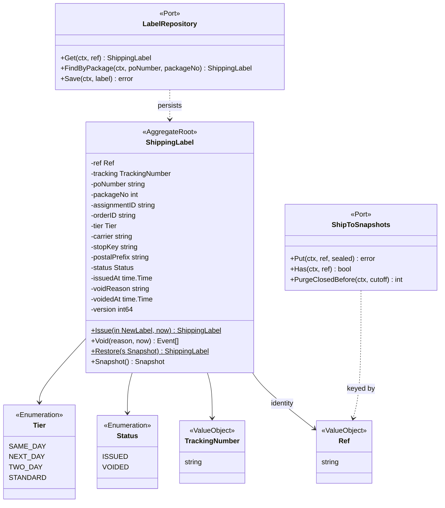
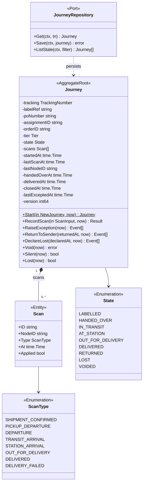
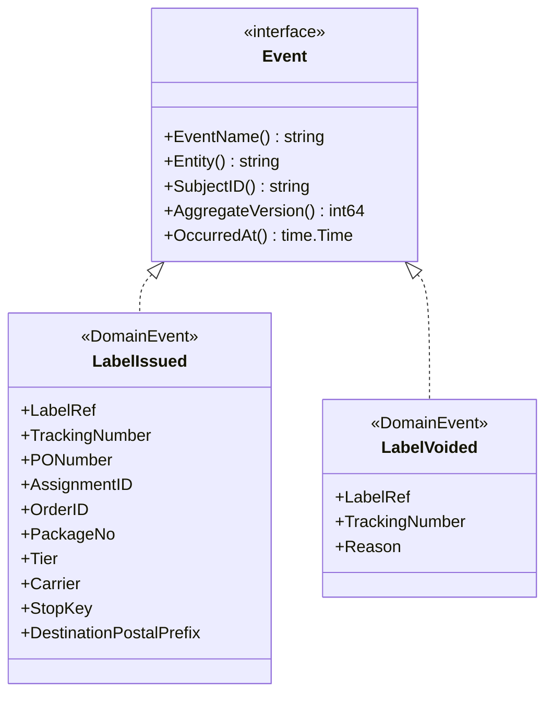
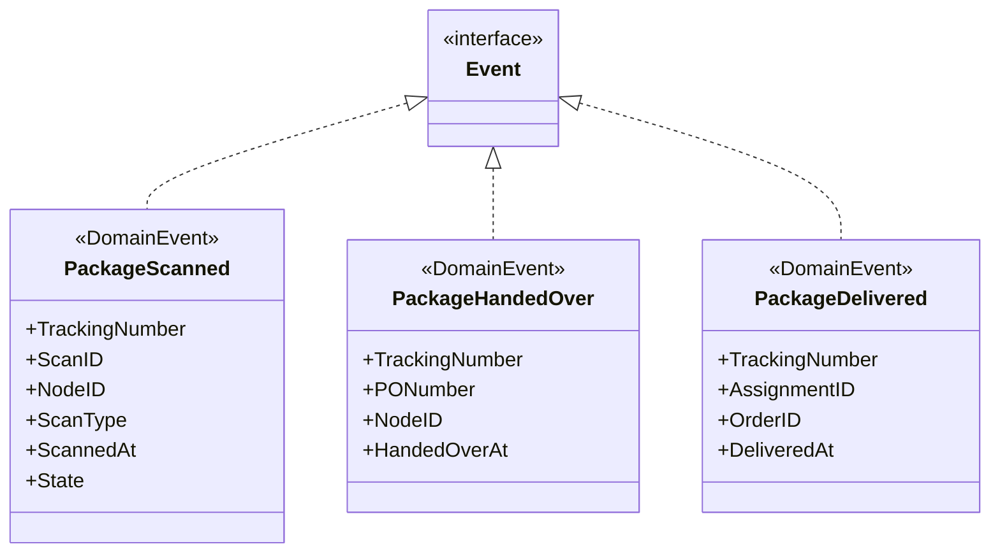
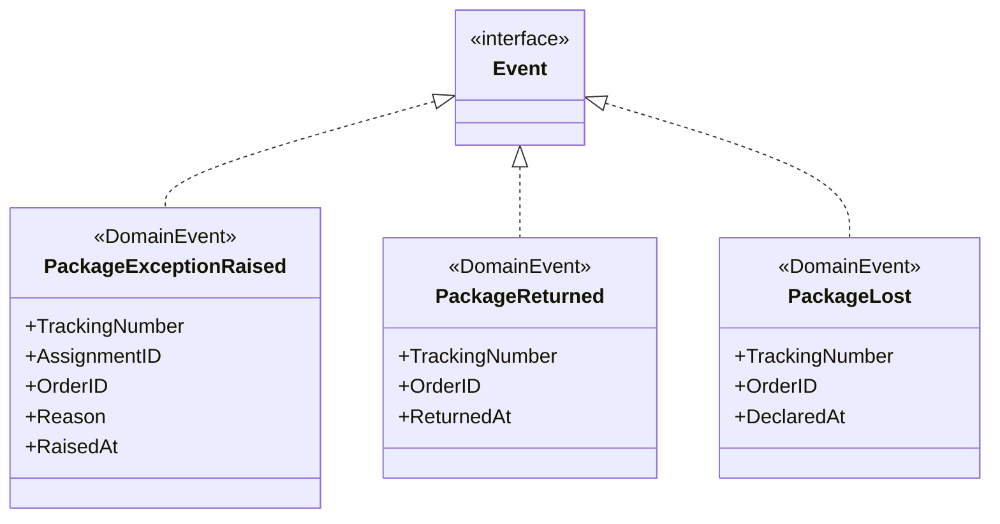
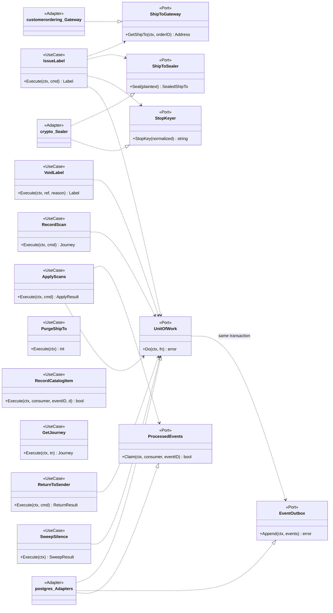

# Class diagram

UML class diagrams for `internal/domain/**` and the application layer, drawn from the Go source. Fields are unexported in Go and shown with `-`; exported methods with `+`. Only state-changing methods and key queries are shown; read accessors are omitted.

## 1. ShippingLabel aggregate

Source: `internal/domain/label/label.go`, `internal/domain/shared/shared.go`, `internal/application/ports/ports.go`. The aggregate holds no address: `ShipToSnapshots` stores the sealed form (`repository.SealedShipTo`: `key_id`, `nonce`, `ciphertext`) apart from it. The carrier is derived (`CarrierFor`). The errors `ErrLabelAlreadyIssued` and `ErrTrackingNumberTaken` are raised by the repository on its unique indexes.

## 2. Journey aggregate

Source: `internal/domain/journey/journey.go`, `internal/domain/journey/types.go`. The edge table `next(ScanType, State)` and the silence windows (`SilenceWindow`) are package functions, not classes. `RecordScan` reports in `Result.Changed` that the aggregate must be saved even when it returns an error (a scan stored out of order or without an edge). The errors `ErrScanOutOfOrder`, `ErrDuplicateScan`, `ErrJourneyClosed` and `ErrVoidAfterHandover` are package variables.

## 3. Domain events

Every event embeds `shared.Header` (`Version`, `At`) and implements `shared.Event` (`EventName`, `Entity`, `SubjectID`, `AggregateVersion`, `OccurredAt`). Three diagrams keep them readable.

Source: `internal/domain/label/events.go`, `internal/domain/shared/shared.go`.

Source: `internal/domain/journey/events.go`. Field names are Go names; on the wire they are camelCase (`ScannedAt` becomes `at` on `PackageScanned`, `RaisedAt` becomes `at` on `PackageExceptionRaised`), see [Domain events](/docs/ddd/domain-events). No event has an address field.

## 4. Use cases, ports and adapters

Source: `internal/application/usecases/*.go`, `internal/application/ports/ports.go`, `internal/adapters/outbound/{customerordering,crypto,postgres}`. Omitted: the repositories, `Clock`, `IDGenerator`, `EventEncoder` and `LabelMetrics` ports, and `Deps`, the struct that hands them to every use case. `PurgeShipTo`, `RecordCatalogItem` and `GetJourney` use the repositories only.

The package layout and the dependency rules enforced by `internal/architecture` are on [Architecture](/docs/overview/architecture).
