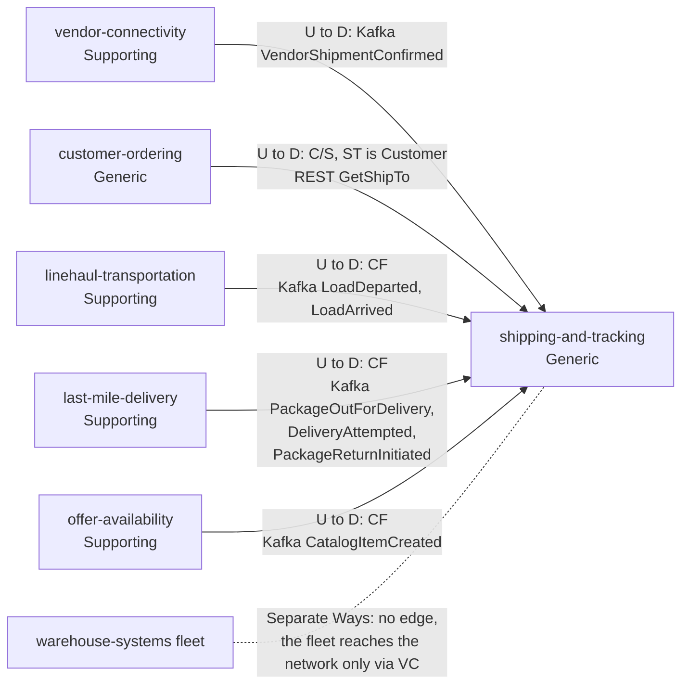
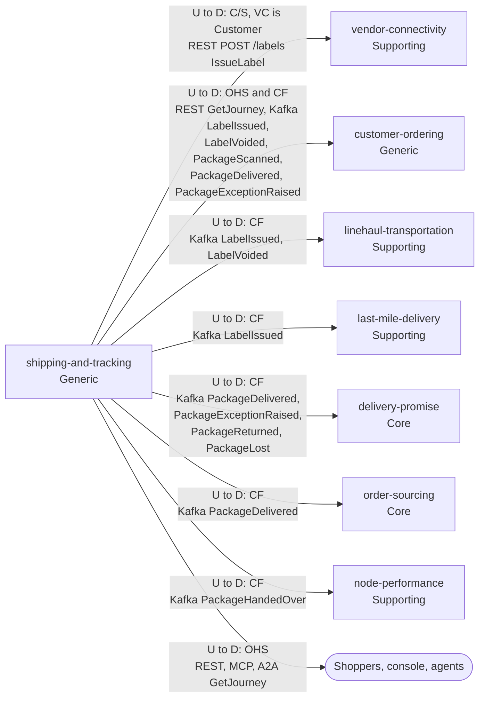

# Context map

Following ddd-crew [Context Mapping](https://github.com/ddd-crew/context-mapping). This is shipping-and-tracking's slice of the [domain-wide context map](https://iqvo.github.io/warehouse-docs/network/strategic-design/context-map): every relationship this context has, with the upstream (U) and downstream (D) side, the pattern and the channel. Classifications are those of [Subdomain classification](/docs/ddd/subdomain-classification). The protocols and failure behaviour of each edge are on [Integration](/docs/ecosystem/integration).

### Upstream: what shipping-and-tracking consumes or calls

Source: `internal/adapters/outbound/customerordering/gateway.go`, `internal/adapters/inbound/kafka/handlers.go`.

### Downstream: who calls or consumes shipping-and-tracking

Source: `apis/openapi.yaml` and the consumer lists in `apis/asyncapi.yaml`. Legend: arrows point from upstream to downstream; CF = Conformist, C/S = Customer/Supplier, OHS = Open Host Service; path parameters are left out of the diagram. The dotted line without an arrow head is a relationship that is deliberately absent.

Omitted: the callers of `POST /journeys/{trackingNumber}/scans` and `POST /labels/{labelRef}:void`, which neither the code nor the contracts name; Postgres and Kafka as infrastructure. There is no edge to node-topology: this context consumes no node event.

## Edges

| Neighbour | Direction | Pattern | Channel | Messages | Why this pattern |
| --- | --- | --- | --- | --- | --- |
| vendor-connectivity (Supporting) | ST upstream, VC downstream | Customer/Supplier (VC is the customer) | REST `POST /labels` | `IssueLabel` | vendor-connectivity needs a label inside a vendor request; this context shapes the route for that one caller |
| vendor-connectivity (Supporting) | VC upstream, ST downstream | Customer/Supplier (ST is the customer) | Kafka `retailnetwork.vendor-connectivity.events` | `VendorShipmentConfirmed` | The vendor's shipment statement names tracking numbers this context issued; both sides agree the fields |
| customer-ordering (Generic) | CO upstream, ST downstream | Customer/Supplier (ST is the customer) | REST `GET {CUSTOMER_ORDERING_URL}/orders/{orderId}/ship-to` | `GetShipTo` | The only synchronous call this context makes, once per label, never on the tracking path |
| customer-ordering (Generic) | ST upstream, CO downstream | Open host service (query) and conformist (events) | REST `GET /journeys/{trackingNumber}`; Kafka `retailnetwork.shipping-and-tracking.events` | `GetJourney`; `LabelIssued`, `LabelVoided`, `PackageScanned`, `PackageDelivered`, `PackageExceptionRaised` | The journey route is open to any reader; customer-ordering takes the events as published |
| linehaul-transportation (Supporting) | LH upstream, ST downstream | Conformist | Kafka `retailnetwork.linehaul-transportation.events` | `LoadDeparted`, `LoadArrived` | Linehaul publishes load facts for its own purposes; this context adapts one load event into one scan per tracking number |
| linehaul-transportation (Supporting) | ST upstream, LH downstream | Conformist | Kafka `retailnetwork.shipping-and-tracking.events` | `LabelIssued`, `LabelVoided` | Linehaul counts expected volume from labels as published |
| last-mile-delivery (Supporting) | LM upstream, ST downstream | Conformist | Kafka `retailnetwork.last-mile-delivery.events` | `PackageOutForDelivery`, `DeliveryAttempted`, `PackageReturnInitiated` | Route facts, one tracking number each, taken as published |
| last-mile-delivery (Supporting) | ST upstream, LM downstream | Conformist | Kafka `retailnetwork.shipping-and-tracking.events` | `LabelIssued` | Stops are grouped by the opaque `stopKey` |
| offer-availability (Supporting) | OA upstream, ST downstream | Conformist | Kafka `retailnetwork.offer-availability.events` | `CatalogItemCreated` | Item dimensions and handling flags for the local `catalog_dimensions` read model |
| delivery-promise (Core) | ST upstream, DP downstream | Conformist | Kafka `retailnetwork.shipping-and-tracking.events` | `PackageDelivered`, `PackageExceptionRaised`, `PackageReturned`, `PackageLost` | The Core context conforms to a Generic one's facts: it needs only the fact and its time |
| order-sourcing (Core) | ST upstream, OS downstream | Conformist | Kafka `retailnetwork.shipping-and-tracking.events` | `PackageDelivered` | Closes the assignment |
| node-performance (Supporting) | ST upstream, NP downstream | Conformist | Kafka `retailnetwork.shipping-and-tracking.events` | `PackageHandedOver` | On-time handover is scored from this context's observed handover, never from the vendor's statement |
| Shoppers, console, agents | ST upstream | Open host service | REST `GET /journeys/{trackingNumber}`, MCP and A2A `get_journey`, the `shipping_mfe` remote | `GetJourney` | Any client may read a journey by tracking number |
| warehouse-systems fleet | none | Separate ways | none | none | The fleet reaches the network only through the Vendor API of vendor-connectivity |

The downstream consumer names come from the AsyncAPI descriptions; this repository does not verify that each consumer is deployed.

## Notes on the patterns

- **Customer/Supplier in both directions with vendor-connectivity.** For the label this context is the supplier; for the shipment statement it is the customer. The label fields and the `trackingNumbers` on `VendorShipmentConfirmed` must agree.
- **Customer of customer-ordering for one query.** A 404 is a validation error on the label request, anything else is `ship-to-unavailable`, and only label issuing degrades.
- **Conformist downstream of the transport contexts.** Load and route events carry what linehaul and last-mile need; this context adapts instead of asking for a new shape, and tolerates absent optional fields (`departureKind`, `nodeType`).
- **No shared kernel, no shared tables.** Ids such as `trackingNumber`, `poNumber`, `orderId` and `nodeId` are values, not foreign keys, and the contracts are restated here and pinned by tests rather than imported.
