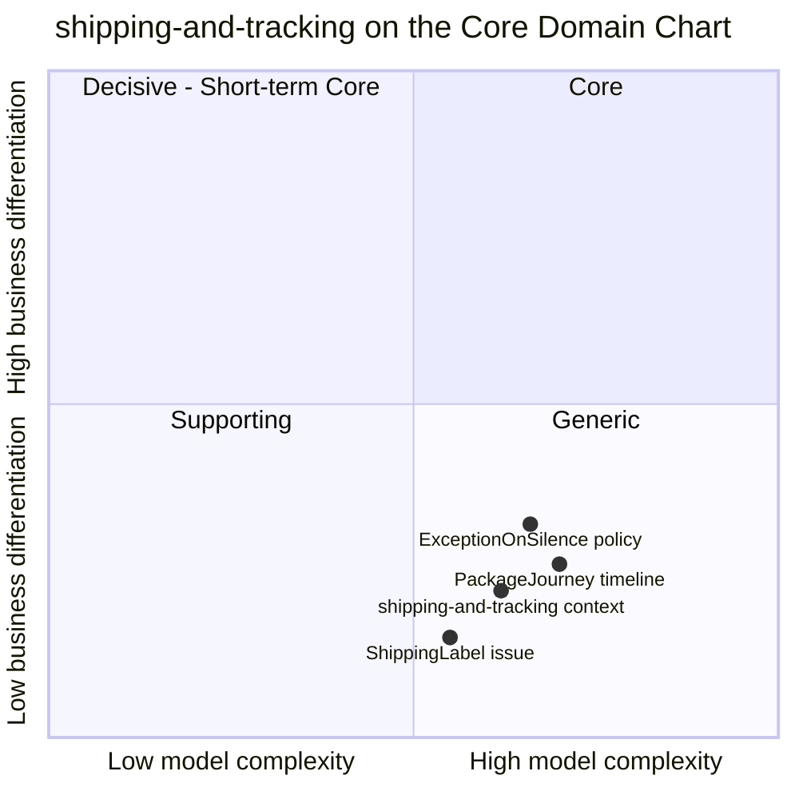

# Core domain chart

Following the ddd-crew [Core Domain Charts](https://github.com/ddd-crew/core-domain-charts): business differentiation (y) against model complexity (x).

Source: the context's placement (`complexity 0.62`, `differentiation 0.22`) is the retail-network model's value, see the central [core domain chart](https://iqvo.github.io/warehouse-docs/network/strategic-design/core-domain-chart); the three slices are placed by this page against `internal/domain/journey/journey.go`, `internal/domain/journey/types.go` and `internal/domain/label/label.go`. They are judgements, not measurements. The other contexts are on the central chart.

## Classification: Generic

All four points sit in quadrant 4 (Generic), bottom right, which matches [Subdomain classification](/docs/ddd/subdomain-classification). Every retail and parcel business has labels and tracking; doing them well is expected, doing them differently wins no customer. The network differentiates on the promise (delivery-promise) and on where an order is sourced (order-sourcing), and both are Core.

**Differentiation is low (y = 0.22).** The context makes no commercial decision. It does not choose a node, a path, a load or a route. It issues an identifier, keeps an address safe and records what other contexts report. The one decision with business weight, which instant counts as handover (`HandoverOnFirstScan` in `Journey.apply`), only feeds a measurement that node-performance owns. The silence policy is plotted highest because an early `NO_SCAN` exception lets delivery-promise re-promise before the customer notices; it is still a generic tracking technique.

**Complexity is moderate to high (x = 0.62).** The timeline is the hard part. `PackageJourney` has nine states and a single edge table (`next` in `types.go`), and it is fed by six consumed event types from three producers on three topics, which arrive in no guaranteed order, with one load event naming many tracking numbers. The aggregate must apply scans in time order, refuse duplicates, store late scans without applying them, and close for good (`ErrScanOutOfOrder`, `ErrDuplicateScan`, `ErrJourneyClosed`). The label side adds a synchronous read of personal data and its encryption at rest. Both are real engineering; neither is a differentiator.

## Business model and evolution

| Axis | Verdict | Why |
| --- | --- | --- |
| Business model | Compliance and experience | A package without a readable label does not move; a shopper without a timeline calls support. Neither earns revenue directly |
| Evolution | Commodity | Label issue and package tracking are mature, well-understood capabilities |

| Part | Evolution stage | Why |
| --- | --- | --- |
| `ShippingLabel` issue | Commodity | One label per package, a unique number, an address. The only network-specific rule is confining the personal data |
| `PackageJourney` timeline | Product, tending to commodity | The consolidation rules are specific to this network's event names; the shape (forward-only scans, terminal outcomes) is standard |
| Handover and silence policies | Custom-built, small | `HandoverOnFirstScan` and `ExceptionOnSilence` encode network choices on top of a generic timeline |

## Movement to watch

A Generic context is a candidate to buy rather than build. If the network adopted an external tracking or label product, this context would shrink to an anti-corruption layer that keeps the event names other contexts consume (`LabelIssued`, `PackageHandedOver`, `PackageDelivered`, `PackageExceptionRaised`). The two policies would stay with the network, because node-performance and delivery-promise depend on their exact definitions. Nothing in the code or the ADRs records such a decision; it would be a new ADR.
