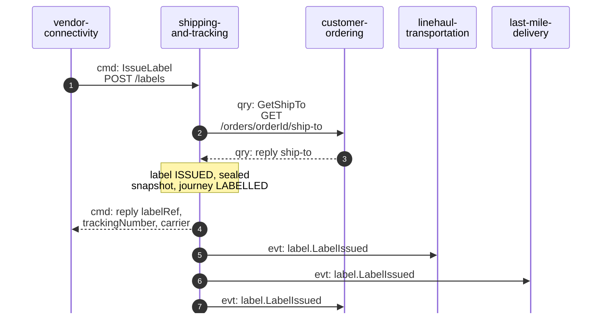
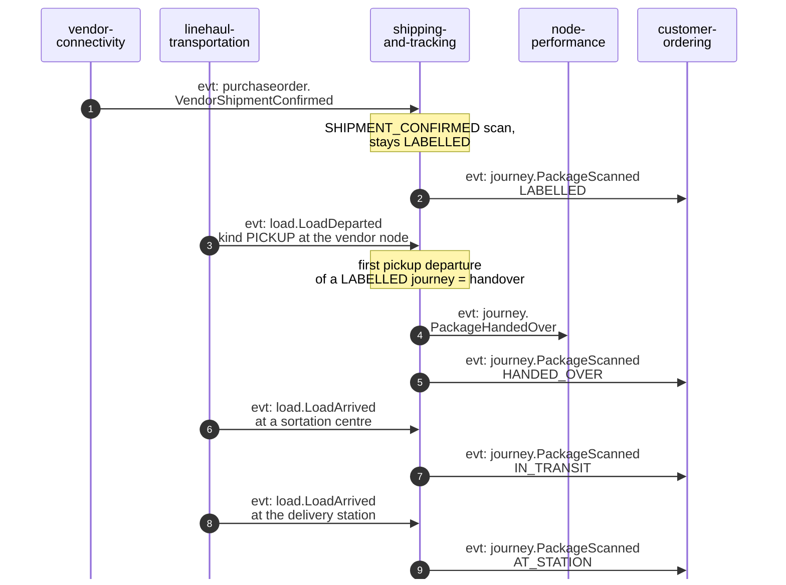
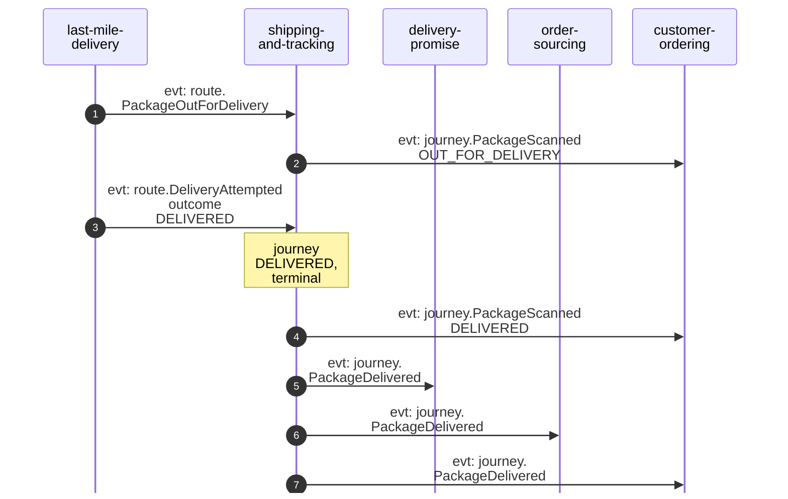
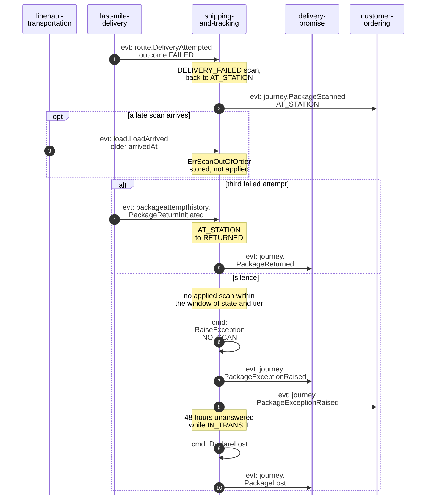

# Domain message flow

Following ddd-crew [Domain Message Flow Modelling](https://github.com/ddd-crew/domain-message-flow-modelling). Participants are contexts and actors. Every arrow is a message this repository sends or handles, prefixed `cmd:`, `qry:` or `evt:`. Events are written `<entity>.<EventName>`; the full type is `com.retailnetwork.<tier>.<producer>.<entity>.<EventName>` (see [Domain events](/docs/ddd/domain-events)). Kafka is not drawn: an event arrow goes straight from producer to consumer. The domain-wide flows are on the central [domain message flows](https://iqvo.github.io/warehouse-docs/network/strategic-design/domain-message-flows) page; the same scenarios as adapter-to-Kafka sequences are on [Sequence diagrams](/docs/ddd/sequence-diagrams).

## 1. A label is issued

Source: `internal/application/usecases/labels.go` (`IssueLabel`), `internal/adapters/outbound/customerordering/gateway.go`, `apis/asyncapi.yaml` (consumers of `LabelIssued`). The request carries `poNumber`, `packageNo`, `assignmentId`, `orderId` and `tier`. Omitted: how vendor-connectivity answers the vendor (never with the address) and the failure branches (ship-to unavailable, duplicate package), drawn on [Sequence diagrams](/docs/ddd/sequence-diagrams).

## 2. Handover and the middle mile

Source: `internal/adapters/inbound/kafka/handlers.go` (`VendorHandlers`, `LinehaulHandlers`), `internal/domain/journey/journey.go` (`apply`). A delivery station is told from a sortation centre by the `nodeType` that `LoadArrived` carries, and a pickup from a linehaul departure by its `departureKind`. A direct-injection lane from the vendor node to the station arrives through the edge `HANDED_OVER` to `AT_STATION`. Omitted: the other consumers of the same upstream events.

## 3. Out for delivery and delivered

Source: `internal/adapters/inbound/kafka/handlers.go` (`LastMileHandlers`), `internal/domain/journey/journey.go` (`apply`). `PackageScanned` and `PackageDelivered` are raised in one transaction. What delivery-promise and order-sourcing do with `PackageDelivered` is theirs to document.

## 4. Failed attempt, return and silence

The most important failure paths: a package that stops moving must reach delivery-promise before the promise date passes, and a package that cannot be delivered must end as `RETURNED`.

Source: `internal/application/usecases/scans.go` (`ReturnToSender`), `internal/application/usecases/sweep.go` (`SweepSilence`), `internal/domain/journey/types.go` (`SilenceWindow`, `LostAfterExceptionHours`). A `PackageReturnInitiated` that arrives before the journey is `AT_STATION` is retried because the failed-attempt scan may still be on its way. Omitted: the next wave's `PackageOutForDelivery`, and what delivery-promise does with the exception.
