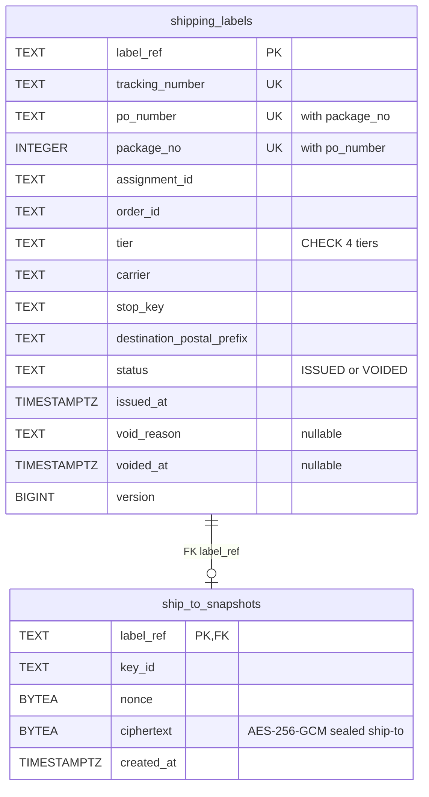
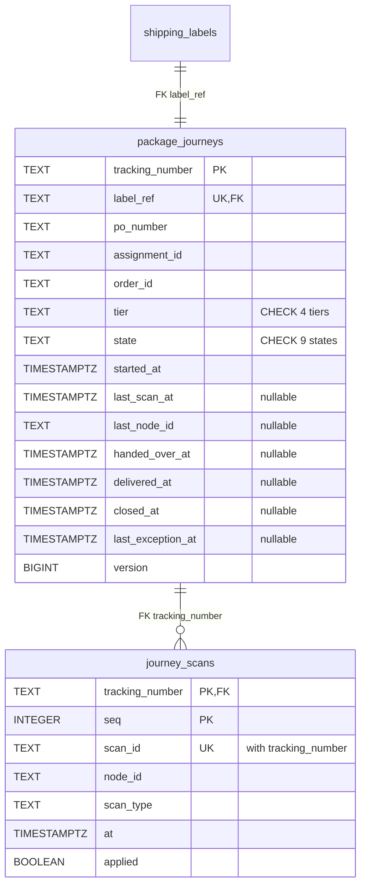
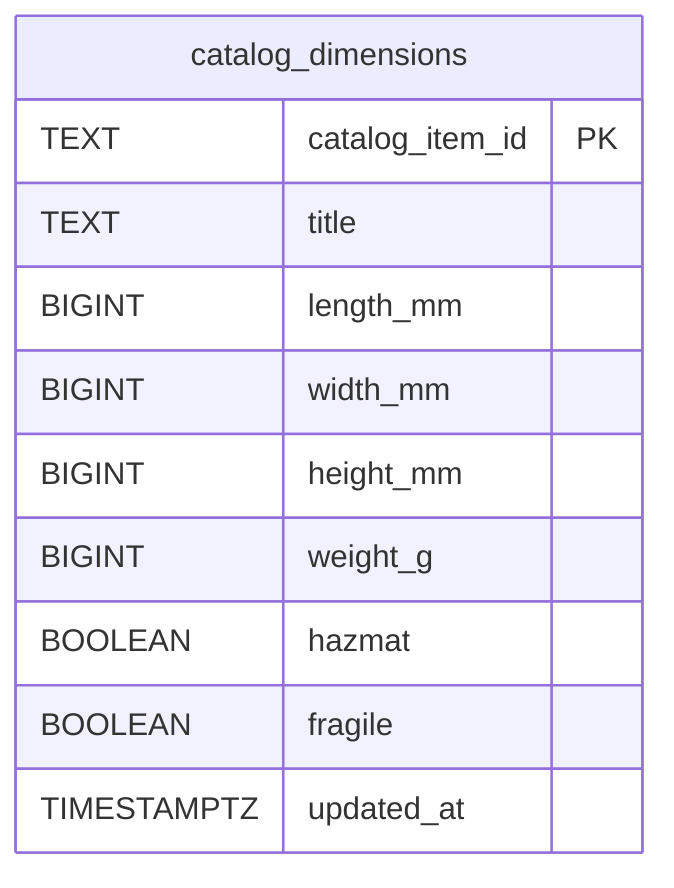
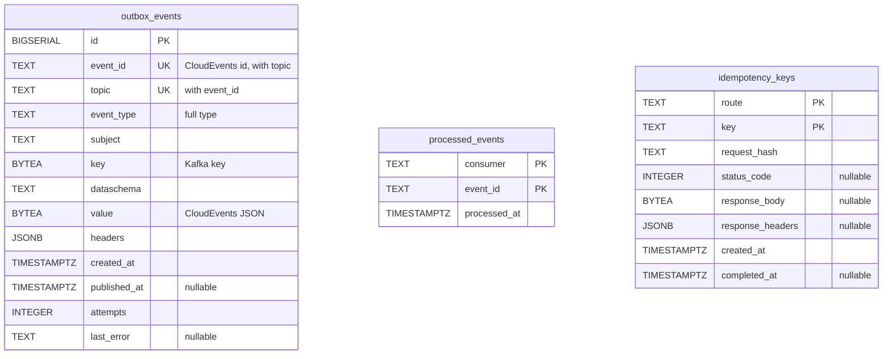

# Entity relationship

The Postgres schema of this context's own database, created by the single embedded migration `internal/adapters/outbound/postgres/migrations/0001_schema.up.sql` and applied by `cmd/api` at boot. No other context reads it. A relationship line is drawn only for a `FOREIGN KEY` in the migration.

## Aggregate and read-model tables

### ShippingLabel

Source: `internal/adapters/outbound/postgres/migrations/0001_schema.up.sql`, `internal/adapters/outbound/postgres/labels.go`. The unique constraint `shipping_labels_tracking_key` enforces `ErrTrackingNumberTaken` and `shipping_labels_package_key` on `(po_number, package_no)` enforces `ErrLabelAlreadyIssued` (Mermaid marks each column `UK`). `ciphertext` is never published or returned. The snapshot row exists only until the purge job deletes it (30 days after the journey closes), so the relationship is zero or one.

### PackageJourney

Source: same migration, `internal/adapters/outbound/postgres/journeys.go`. `journey_scans` rows are append-only; `seq` is the recorded order, `(tracking_number, scan_id)` is unique and enforces `ErrDuplicateScan`, `applied = false` keeps a late scan. `version` is the optimistic-concurrency check. `last_exception_at` stops the sweep raising the same silence twice. Two partial indexes: `idx_package_journeys_stale (last_scan_at, tracking_number)` for open states past `LABELLED` (the silence sweep) and `idx_package_journeys_closed (closed_at)` for closed journeys (the ship-to purge). `journey_scans` rows are deleted with their journey (`ON DELETE CASCADE`), though no code path deletes a journey.

### Catalog dimensions

Source: same migration, `ports.CatalogDimensionsView`. Upserted on `CatalogItemCreated`; nothing references it.

## Infrastructure tables

Source: same migration. `outbox_events` is the transactional outbox (written in the same transaction as the aggregate, drained by the relay to `retailnetwork.shipping-and-tracking.events`, with a partial index on unpublished rows). `processed_events` is the consumer inbox, one claim per `(consumer, event_id)`. `idempotency_keys` stores the first response per `Idempotency-Key` on the three POST routes; `response_body` holds label metadata or a journey, never the address. Retention by the `housekeeping` job: idempotency keys 24 hours, relayed outbox rows 7 days, inbox claims 30 days (`internal/adapters/outbound/postgres/housekeeping.go`, `cmd/api/main.go`).

The migration tool keeps its own bookkeeping table (the golang-migrate default `schema_migrations`), which the SQL file does not create and is not drawn.

## Foreign keys

- **Inside this context.** `package_journeys.label_ref` references `shipping_labels` (unique, one journey per label) and `ship_to_snapshots.label_ref` references its label. These are the only foreign keys. They exist because `IssueLabel` writes label, snapshot and journey in one unit of work, and `VoidLabel` updates label and journey in one unit. The Go aggregates still refer to each other by value (`labelRef`, `trackingNumber`), never by object.
- `po_number`, `assignment_id`, `order_id`, `node_id` and `catalog_item_id` are ids owned by vendor-connectivity, order-sourcing, customer-ordering, the transport contexts and offer-availability. Their rows live in other databases; a foreign key is impossible and would break context autonomy.
- `catalog_dimensions` is a copy fed by events, rebuilt by replay. Nothing references it.

## Table and aggregate

| Table | Aggregate or role | Notes |
| --- | --- | --- |
| `shipping_labels` | ShippingLabel (root) | One row per label. Unique `(po_number, package_no)` and `tracking_number` |
| `ship_to_snapshots` | ShippingLabel (its sealed snapshot) | Kept apart so the personal data can be purged without touching the label row. Purged 30 days after the journey closes |
| `package_journeys` | PackageJourney (root) | One row per package; `version` for optimistic concurrency, because four topics and REST write it |
| `journey_scans` | PackageJourney (its `Scan` entities) | Append-only |
| `catalog_dimensions` | none (read model) | Upsert on `CatalogItemCreated` |
| `outbox_events` | none (infrastructure) | Transactional outbox |
| `processed_events` | none (infrastructure) | Consumer inbox |
| `idempotency_keys` | none (infrastructure) | REST idempotency |
