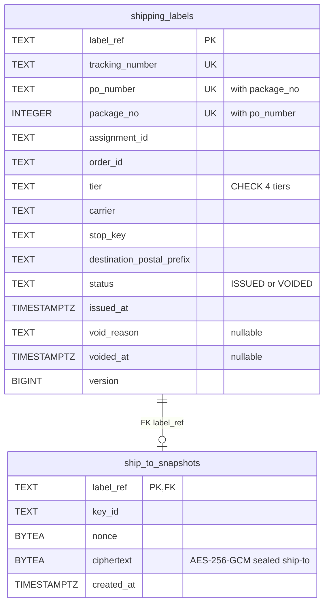
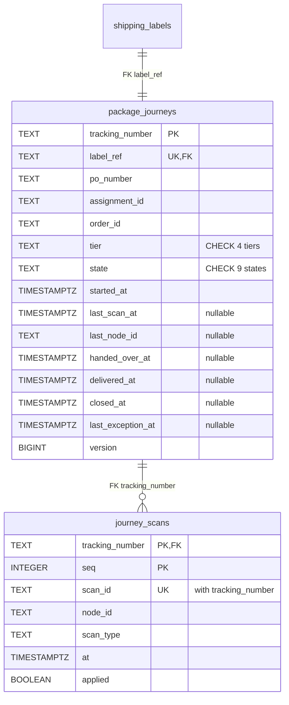
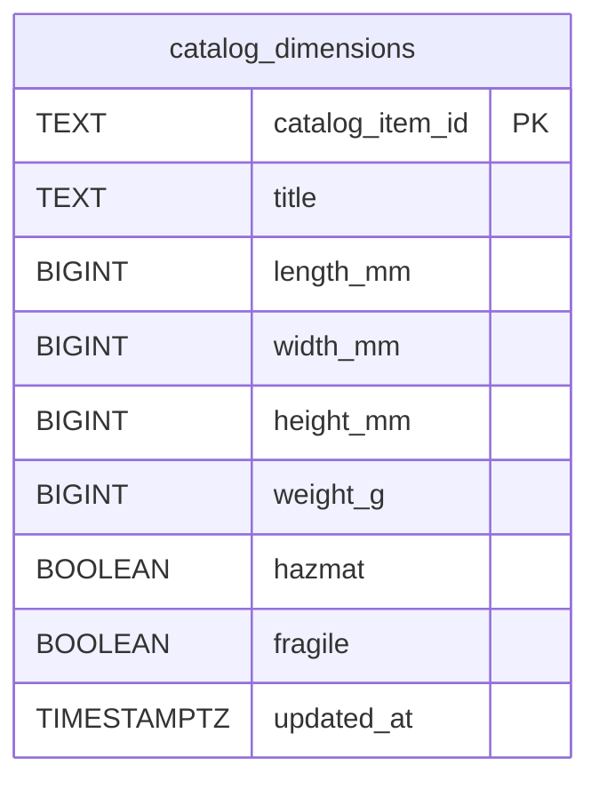
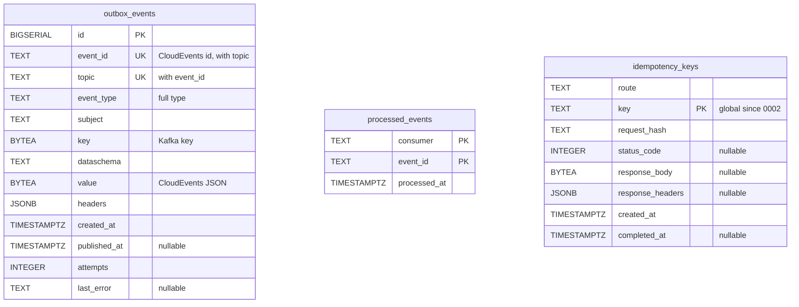
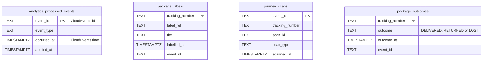

# Entity relationship

This context has two Postgres databases, each with its own embedded migrations. The OLTP database holds eight tables, created by `internal/adapters/outbound/postgres/migrations/0001_schema.up.sql` and amended by `0002_idempotency_key_global.up.sql`, and is applied at boot by `cmd/api`, `cmd/mcp` and `cmd/a2a`. The analytical database holds four tables, created by `analytics/migrations/0001_delivery_facts.up.sql` and applied by `cmd/st-projector` (ADR 0012). No other context reads either. A relationship line is drawn only for a `FOREIGN KEY` in a migration; the first diagrams below are the OLTP database, the last section is the analytical one.

## Aggregate and read-model tables

### ShippingLabel

Source: `internal/adapters/outbound/postgres/migrations/0001_schema.up.sql`, `internal/adapters/outbound/postgres/labels.go`. The unique constraint `shipping_labels_tracking_key` enforces `ErrTrackingNumberTaken` and `shipping_labels_package_key` on `(po_number, package_no)` enforces `ErrLabelAlreadyIssued` (Mermaid marks each column `UK`). `ciphertext` is never published or returned. The snapshot row exists only until the purge job deletes it (30 days after the journey closes), so the relationship is zero or one.

### PackageJourney

Source: same migration, `internal/adapters/outbound/postgres/journeys.go`. `journey_scans` rows are append-only; `seq` is the recorded order, `(tracking_number, scan_id)` is unique and enforces `ErrDuplicateScan`, `applied = false` keeps a late scan. `version` is the optimistic-concurrency check. `last_exception_at` stops the sweep raising the same silence twice. Two partial indexes: `idx_package_journeys_stale (last_scan_at, tracking_number)` for open states past `LABELLED` (the silence sweep) and `idx_package_journeys_closed (closed_at)` for closed journeys (the ship-to purge). `journey_scans` rows are deleted with their journey (`ON DELETE CASCADE`), though no code path deletes a journey.

### Catalog dimensions

Source: same migration, `ports.CatalogDimensionsView`. Upserted on `CatalogItemCreated`; nothing references it.

## Infrastructure tables

Source: `0001_schema.up.sql`, and `0002_idempotency_key_global.up.sql` for the `idempotency_keys` primary key (`key` alone, ADR 0010: the same key on another route is a reuse, not a new key). `outbox_events` is the transactional outbox (written in the same transaction as the aggregate, drained by the relay to `retailnetwork.shipping-and-tracking.events`, with a partial index on unpublished rows). `processed_events` is the consumer inbox, one claim per `(consumer, event_id)`. `idempotency_keys` stores the first response per `Idempotency-Key` on the three POST routes, looked up by `key` (`ON CONFLICT (key)`, `internal/adapters/inbound/http/idempotency.go`); `response_body` holds label metadata or a journey, never the address. Retention by the `housekeeping` job: idempotency keys 24 hours, relayed outbox rows 7 days, inbox claims 30 days (`internal/adapters/outbound/postgres/housekeeping.go`, `cmd/api/main.go`).

The migration tool keeps its own bookkeeping table in each database (the golang-migrate default `schema_migrations`), which the SQL files do not create and is not drawn.

## Foreign keys

- **Inside the OLTP database.** `package_journeys.label_ref` references `shipping_labels` (unique, one journey per label) and `ship_to_snapshots.label_ref` references its label. These are the only foreign keys. They exist because `IssueLabel` writes label, snapshot and journey in one unit of work, and `VoidLabel` updates label and journey in one unit. The Go aggregates still refer to each other by value (`labelRef`, `trackingNumber`), never by object.
- `po_number`, `assignment_id`, `order_id`, `node_id` and `catalog_item_id` are ids owned by vendor-connectivity, order-sourcing, customer-ordering, the transport contexts and offer-availability. Their rows live in other databases; a foreign key is impossible and would break context autonomy.
- `catalog_dimensions` is a copy fed by events, rebuilt by replay. Nothing references it.

## Table and aggregate (OLTP database)

| Table | Aggregate or role | Notes |
| --- | --- | --- |
| `shipping_labels` | ShippingLabel (root) | One row per label. Unique `(po_number, package_no)` and `tracking_number` |
| `ship_to_snapshots` | ShippingLabel (its sealed snapshot) | Kept apart so the personal data can be purged without touching the label row. Purged 30 days after the journey closes |
| `package_journeys` | PackageJourney (root) | One row per package; `version` for optimistic concurrency, because four topics and REST write it |
| `journey_scans` | PackageJourney (its `Scan` entities) | Append-only |
| `catalog_dimensions` | none (read model) | Upsert on `CatalogItemCreated` |
| `outbox_events` | none (infrastructure) | Transactional outbox |
| `processed_events` | none (infrastructure) | Consumer inbox |
| `idempotency_keys` | none (infrastructure) | REST idempotency |

## Analytical database tables

The analytical database is separate from the OLTP one. It is a projection of this context's own topic `retailnetwork.shipping-and-tracking.events`, written only by `cmd/st-projector` and read read-only by `cmd/st-reports`; it can be dropped and rebuilt from the topic (ADR 0012). The table `journey_scans` below is not the OLTP table of the same name: it is a different table with a different shape, in a different database.

Source: `analytics/migrations/0001_delivery_facts.up.sql`, `internal/adapters/outbound/analyticsstore/projection.go`, `reader.go`. The migration declares no foreign keys, so no relationship line is drawn. The tables are still related by value: the reports join `package_outcomes` to `journey_scans` (counted per `tracking_number` and `scan_type`) and left-join `package_labels` on `tracking_number` for the tier, which is `UNKNOWN` until the label is projected.

- `analytics_processed_events` is the idempotency claim: the projector inserts the event id (`ON CONFLICT (event_id) DO NOTHING`) in the same transaction as the fact it projects, so a replayed id is a no-op. `max(occurred_at)` is the basis of the freshness report.
- `package_labels` has one row per tracking number from `label.LabelIssued`, upserted on `tracking_number`.
- `journey_scans` has one row per `journey.PackageScanned` event; the key is the event id and `scanned_at` is the scan's own instant.
- `package_outcomes` has one row per tracking number, upserted on `tracking_number`, from `journey.PackageDelivered`, `PackageReturned` or `PackageLost`; `outcome` is constrained to `DELIVERED`, `RETURNED` or `LOST`.
- `tracking_number`, `label_ref`, `tier`, `scan_id` and `scan_type` are `CHECK (... <> '')` non-empty. Three indexes: `idx_journey_scans_tracking_type (tracking_number, scan_type)`, `idx_package_outcomes_outcome_at (outcome_at)` and `idx_analytics_processed_events_occurred_at (occurred_at)`.

| Table | Role | Notes |
| --- | --- | --- |
| `analytics_processed_events` | none (idempotency claim) | One row per applied CloudEvents id |
| `package_labels` | fact (tier of a package) | Key `tracking_number` |
| `journey_scans` | fact (one scan) | Key `event_id`; analytical database only |
| `package_outcomes` | fact (terminal state) | Key `tracking_number`; one terminal state per journey |
