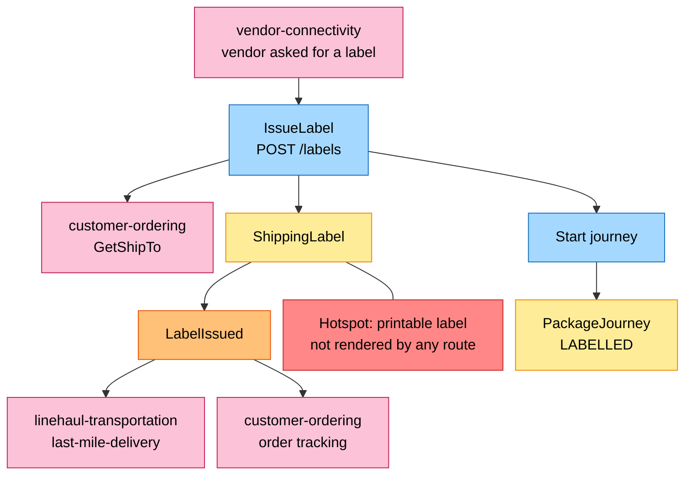
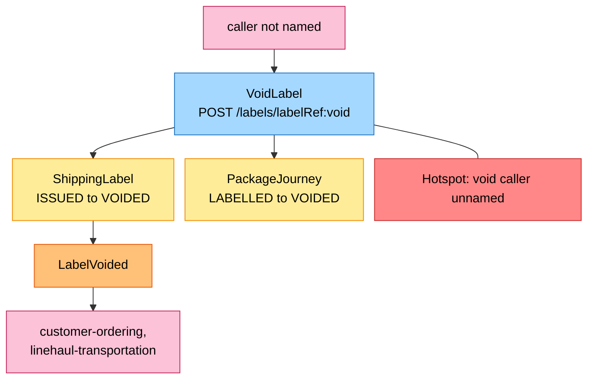
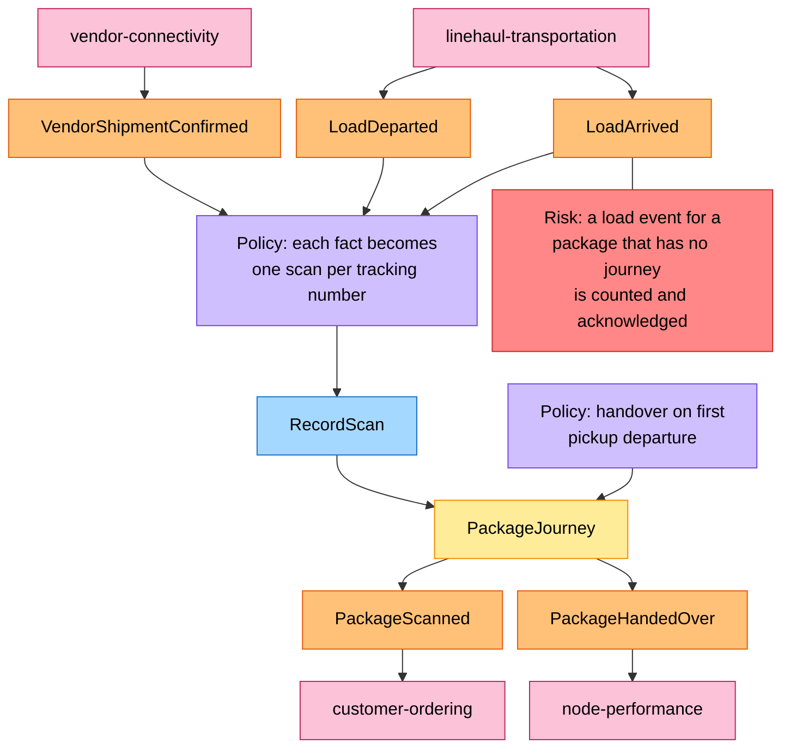
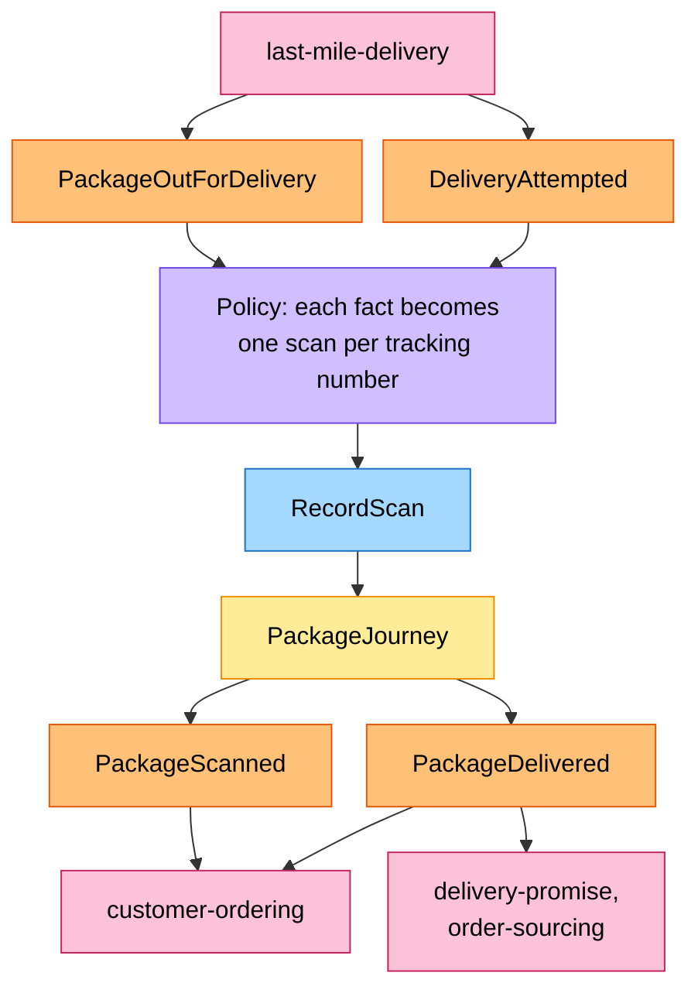
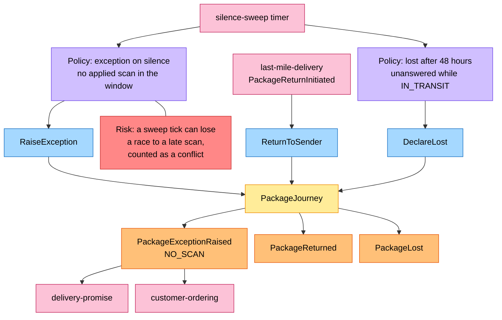

# EventStorming

Process-level boards in the ddd-crew [EventStorming glossary and cheat sheet](https://github.com/ddd-crew/eventstorming-glossary-cheat-sheet) notation. Every sticky comes from the code of this repository; the hotspots are the gaps or risks that remain in what is built, and the inventory at the end says where each one comes from. The domain-wide board is [EventStorming big picture](https://iqvo.github.io/warehouse-docs/network/strategic-design/eventstorming-big-picture).

## Legend

| Colour | Sticky | Meaning |
| --- | --- | --- |
| Blue `#a5d8ff` | Command | An intent this context handles |
| Yellow `#ffec99` | Aggregate | `ShippingLabel` or `PackageJourney` |
| Orange `#ffc078` | Domain event | A fact, this context's or a neighbour's |
| Lilac `#d0bfff` | Policy | "Whenever X, then Y" |
| Green `#b2f2bb` | Read model | Data a decision reads |
| Pink `#fcc2d7` | External system | A neighbour context or actor |
| Red `#ff8787` | Hotspot | A gap or risk |

## 1. Label issue

Source: `internal/application/usecases/labels.go` (`IssueLabel.execute`, `create`), `internal/domain/label/label.go`, `internal/domain/journey/journey.go` (`Start`). The label, its sealed snapshot, the journey and the outbox row are one transaction. Omitted: the duplicate-label and ship-to-unavailable branches (see [Use cases](/docs/ddd/use-cases)) and the outbox relay.

### 1b. Label void

Source: `internal/application/usecases/labels.go` (`VoidLabel.Execute`), `internal/domain/journey/journey.go` (`Void`). The journey closes as `VOIDED` in the same transaction and raises no event of its own; a handed-over package is `ErrVoidAfterHandover`.

## 2. Timeline consolidation

### 2a. Handover and the middle mile

Source: `internal/adapters/inbound/kafka/handlers.go` (`VendorHandlers`, `LinehaulHandlers`), `internal/application/usecases/scans.go` (`ApplyScans`), `internal/domain/journey/journey.go` (`apply`). Omitted: the REST route `POST /journeys/{trackingNumber}/scans` (same use case, caller not named); duplicate and out-of-order scans (stored or refused, no event).

### 2b. Last mile

Source: `internal/adapters/inbound/kafka/handlers.go` (`LastMileHandlers`). A failed attempt returns the journey to `AT_STATION` and raises `PackageScanned` only.

## 3. Exceptions and terminal outcomes

Source: `internal/application/usecases/sweep.go` (`SweepSilence`, `decide`), `internal/application/usecases/scans.go` (`ReturnToSender`), `internal/domain/journey/types.go`. Omitted: `ErrJourneyClosed` on a closed journey.

## Sticky inventory

| Sticky | Kind | Source |
| --- | --- | --- |
| `IssueLabel`, `VoidLabel` | Command | `usecases/labels.go` |
| Start journey, `RecordScan`, `RaiseException`, `ReturnToSender`, `DeclareLost` | Command | `journey/journey.go`, `usecases/scans.go`, `usecases/sweep.go` |
| `ShippingLabel`, `PackageJourney` | Aggregate | `domain/label`, `domain/journey` |
| `LabelIssued`, `LabelVoided`, `PackageScanned`, `PackageHandedOver`, `PackageDelivered`, `PackageExceptionRaised`, `PackageReturned`, `PackageLost` | Domain event (own) | `label/events.go`, `journey/events.go` |
| `VendorShipmentConfirmed`, `LoadDeparted`, `LoadArrived`, `PackageOutForDelivery`, `DeliveryAttempted`, `PackageReturnInitiated` | Domain event (neighbour) | `inbound/kafka/handlers.go` |
| Handover on first pickup departure, exception on silence, lost after 48 hours | Policy | `journey.apply`, `journey.SilenceWindow`, `Journey.Lost` |
| `catalog_dimensions` | Read model | `ports.CatalogDimensionsView` |
| `vendor-connectivity`, `customer-ordering`, `linehaul-transportation`, `last-mile-delivery`, `delivery-promise`, `order-sourcing`, `node-performance` | External system | `apis/asyncapi.yaml`, `outbound/customerordering` |

## Hotspots and where they come from

| Hotspot | Board | Source |
| --- | --- | --- |
| Printable label not rendered | 1 | No route of `apis/openapi.yaml` returns anything printable; the response is the label metadata |
| `VoidLabel` and `RecordScan` have no named caller | 1b, 2a | The routes are unauthenticated and the contracts name no caller |
| A load or route event for an unknown tracking number | 2a | `ApplyScans` counts it as unknown and acknowledges it (`internal/application/usecases/scans.go`) |
| Sweep race with a late scan | 3 | `SweepSilence` counts `ErrConcurrentUpdate` as a conflict and sees the journey again on the next tick |
