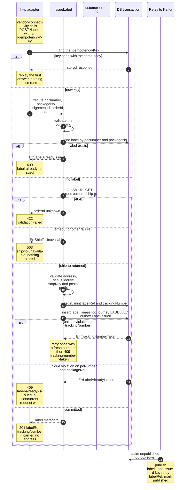
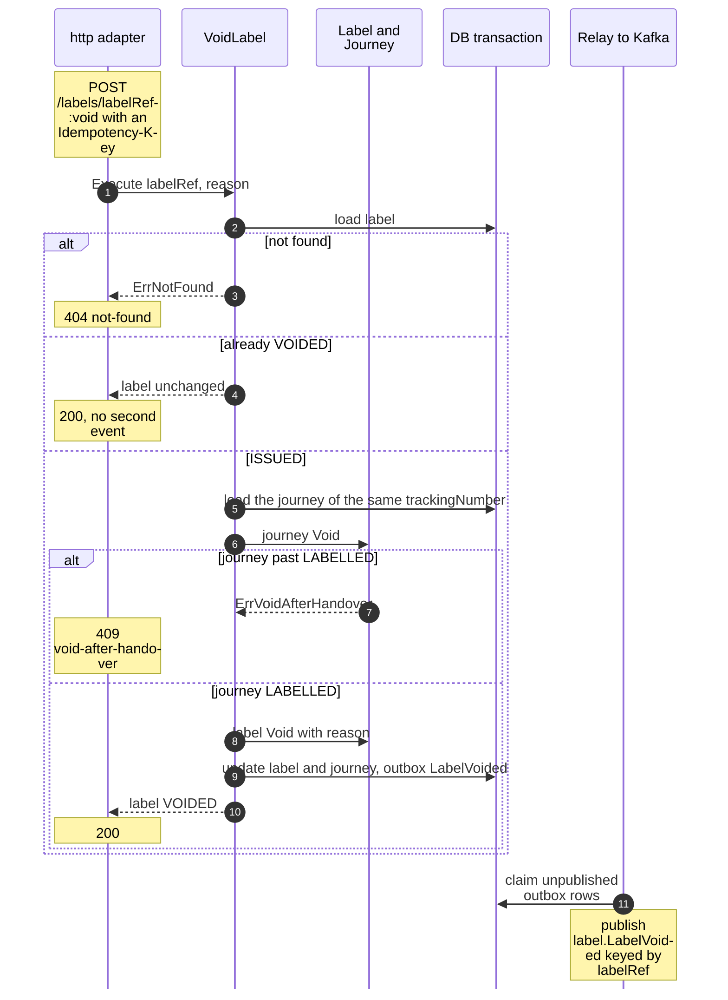
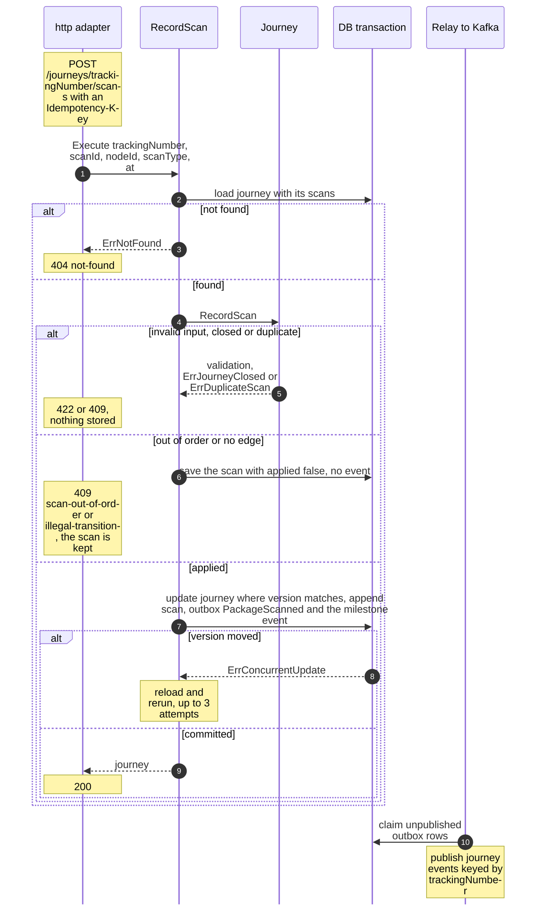
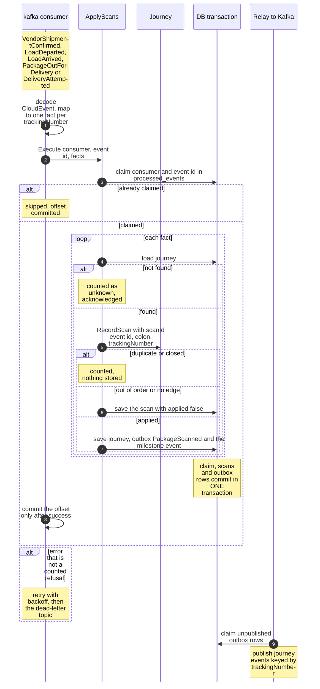
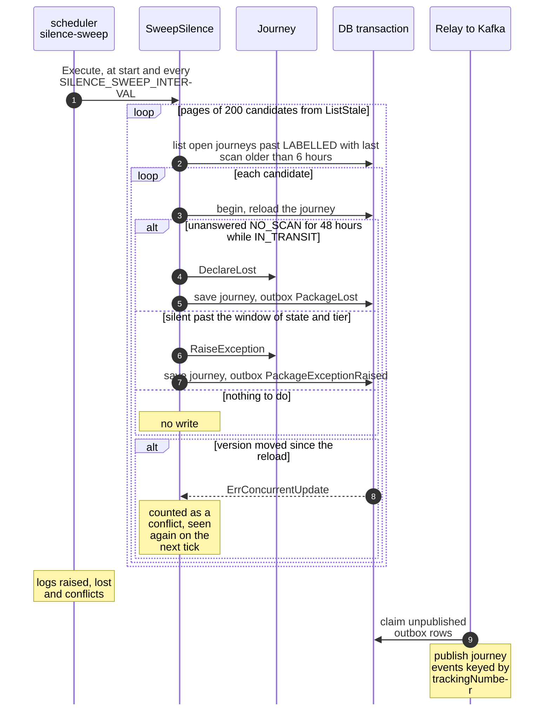
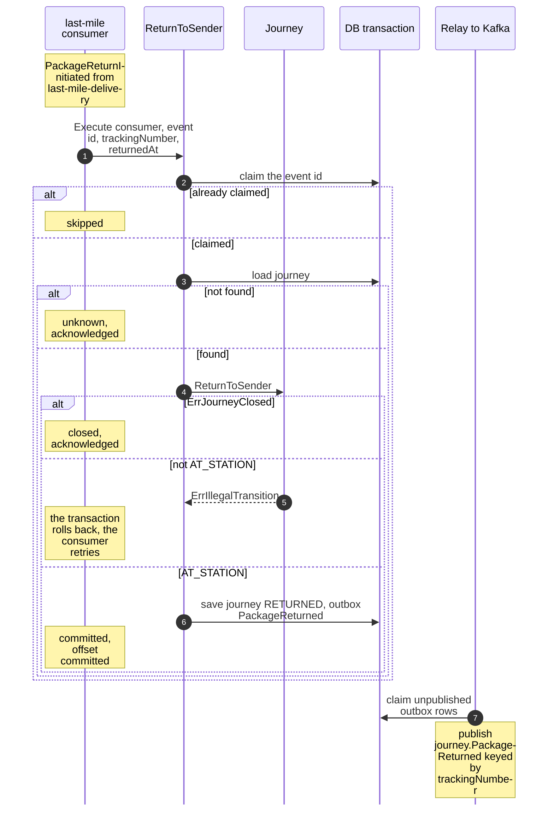

# Sequence diagrams

One sequence diagram per command use case of [Use cases](/docs/ddd/use-cases). To stay readable, `DB` stands for one Postgres transaction that holds the repositories, the `outbox_events` insert and, for consumers, the `processed_events` insert. `Relay` stands for the outbox relay (`internal/adapters/outbound/outbox/relay.go`) that publishes committed rows to the Kafka topic `retailnetwork.shipping-and-tracking.events`. The relay always runs after the commit, never inside it.

## 1. IssueLabel (with Start journey)

Source: `internal/application/usecases/labels.go` (`execute`, `issue`, `create`), `internal/adapters/inbound/http/idempotency.go`, `internal/adapters/outbound/customerordering/gateway.go`. The call to customer-ordering is made before the transaction opens. The label, the sealed snapshot, the journey, the outbox row and the stored idempotency answer commit together. Omitted: the ship-to validation failure branch (`validation-failed`).

## 2. VoidLabel

Source: `internal/application/usecases/labels.go` (`VoidLabel.Execute`). A journey that is already closed answers `journey-closed`. The journey closes as `VOIDED` and raises no event of its own.

## 3. RecordScan (REST)

Source: `internal/application/usecases/scans.go` (`RecordScan.Execute`), `internal/domain/journey/journey.go` (`RecordScan`), `internal/application/usecases/writer.go` (`transact`, `maxAttempts`). A third failure to commit leaves `concurrent-update` (409).

## 4. ApplyScans (Kafka consumers)

Source: `internal/application/usecases/scans.go` (`ApplyScans.Execute`, `applyOne`, `count`), `internal/adapters/inbound/kafka/handlers.go`, `internal/adapters/inbound/kafka/consumer.go`. The inbox claim shares the transaction with every journey of the event, so a redelivery after a commit is skipped as a whole and a rollback releases the claim. The same shape serves `PackageReturnInitiated` through `ReturnToSender` (diagram 6).

## 5. SweepSilence: RaiseException and DeclareLost

Source: `internal/application/usecases/sweep.go`, `internal/domain/journey/types.go` (`SilenceWindow`, `MinSilenceWindow`), `internal/scheduler/scheduler.go`. Each journey is decided in its own unit, so one conflict never aborts the page.

## 6. ReturnToSender

Source: `internal/application/usecases/scans.go` (`ReturnToSender.Execute`), `internal/adapters/inbound/kafka/handlers.go` (`LastMileHandlers`). A rollback also releases the inbox claim, so the retry runs again.
