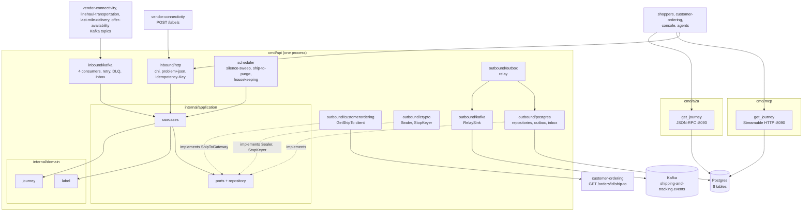

# Architecture

Shipping & Tracking follows the fleet's hexagonal (ports and adapters) layout: dependencies point inward, the domain imports nothing from the rest of the module, and only `cmd/` wires the layers together. The fitness tests in `internal/architecture` enforce it (see [Testing](/docs/development/testing)).

## Layout

| Layer | Path | Role |
| --- | --- | --- |
| Domain | `internal/domain/label` | `ShippingLabel` aggregate (`ISSUED`, `VOIDED`): identity `labelRef`, tracking number, tier, carrier, opaque `stopKey`, postal prefix, optimistic `version`. Events `LabelIssued`, `LabelVoided`. Pure Go: clock and ids are arguments, `Snapshot`/`Restore` |
| Domain | `internal/domain/journey` | `PackageJourney` aggregate with its `Scan` entities: nine states, eight scan types, the edge table, the silence policy. Events `PackageScanned`, `PackageHandedOver`, `PackageDelivered`, `PackageExceptionRaised`, `PackageReturned`, `PackageLost` |
| Domain | `internal/domain/shared` | `Tier`, `TrackingNumber`, id validation, `ErrValidation`, `ErrIllegalTransition`, the event header |
| Application | `internal/application/usecases` | The use cases (see [Use cases](/docs/ddd/use-cases)) and the `writer` skeleton that saves an aggregate and hands its events to the outbox inside one unit of work |
| Application | `internal/application/{ports,repository,outbox,shipto,views}` | The OUT ports (`ShipToGateway`, `ShipToSealer`, `StopKeyer`, repositories, `UnitOfWork`, `Clock`, `IDGenerator`, `LabelMetrics`), the records they exchange, the already-encoded outbox `Message`, the `shipto.Address` value object that redacts itself, and the read views |
| Inbound adapter | `internal/adapters/inbound/http` | chi router for `apis/openapi.yaml`: handlers, RFC 9457 problem mapping (`errors.go`), the `Idempotency-Key` middleware, `/healthz`, `/readyz`. No auth middleware |
| Inbound adapter | `internal/adapters/inbound/kafka` | The four consumers (vendor, linehaul, last-mile, catalog): CloudEvents decode, dispatch on the full `type`, retry with capped backoff, `<topic>.dlq`, consumer spans |
| Inbound adapter | `internal/adapters/inbound/mcp`, `.../a2a` | The read-only MCP tool and A2A skill `get_journey` |
| Inbound adapter | `internal/adapters/inbound/requestlog` | Access-log middleware shared by the REST, MCP and A2A routers |
| Scheduler | `internal/scheduler` | Runs the three periodic jobs (`silence-sweep`, `ship-to-purge`, `housekeeping`) |
| Outbound adapter | `internal/adapters/outbound/postgres` (+ `pgtx`, `migrations/`) | pgxpool repositories, unit of work, outbox repository, inbox (`processed_events`), housekeeping, embedded migrations |
| Outbound adapter | `internal/adapters/outbound/outbox` | The relay loop that drains `outbox_events` to a sink |
| Outbound adapter | `internal/adapters/outbound/kafka` | Event `Encoder` (topic constant), `RelaySink` and `BrokerCheck` (the Kafka half of `/readyz`) |
| Outbound adapter | `internal/adapters/outbound/customerordering` | The `GetShipTo` REST client |
| Outbound adapter | `internal/adapters/outbound/crypto` | AES-256-GCM `Sealer` for the ship-to snapshot and the HMAC-SHA-256 `StopKeyer` |
| Outbound adapter | `internal/adapters/outbound/{ids,clock,telemetry}` | Random ids, the system clock, OpenTelemetry setup and the `shipping.labels.issued` counter |
| Outbound adapter | `internal/adapters/outbound/memory` | In-memory implementation of every port: a **test double** for unit and godog suites. No binary imports it (`TestRuntimeBinaryHasNoInMemoryAdapters`) |
| Kafka envelope | `internal/adapters/kafka/cloudevents` | The only place a CloudEvents 1.0 envelope is built or decoded |
| Support | `internal/bootretry` | Backoff retry for the first outbound dials (migrations, Postgres ping) |
| Composition roots | `cmd/api`, `cmd/mcp`, `cmd/a2a` | Environment parsing, wiring, shutdown order |
| Test support | `internal/testing/{pgtest,kafkatest}`, `internal/adapters/outbound/repocontract` | testcontainers helpers and the repository contract suite run against memory and Postgres |
| Fitness tests | `internal/architecture` | Dependency rules and contract guards |

## Binaries and ports

| Binary | Role | Port | Probes |
| --- | --- | --- | --- |
| `cmd/api` | REST API, outbox relay, the four Kafka consumers and the three periodic jobs in one process, all always on, on real Postgres and Kafka | `HTTP_ADDR`, default `:8080` | `GET /healthz` (liveness), `GET /readyz` (drain gate, Postgres ping, a Kafka broker answers a metadata request) |
| `cmd/mcp` | Read-only MCP server, Streamable HTTP only, tool `get_journey` ([ADR 0006](/docs/adr/0006-mcp-server-adoption)). No Kafka, relay, consumer or job | `MCP_ADDR`, default `:8090` | `GET /healthz` |
| `cmd/a2a` | Read-only A2A agent: JSON-RPC 2.0 at `/` and `/a2a`, Agent Card at `/.well-known/agent-card.json`, skill `get_journey` ([ADR 0009](/docs/adr/0009-a2a-inbound-adapter)). No Kafka, relay, consumer or job | `A2A_ADDR`, default `:8093` | `GET /healthz` |

`web/` is not a Go binary: it is the `shipping_mfe` Module Federation console remote ([ADR 0007](/docs/adr/0007-console-remote)), a read-only screen over the journey API, served by its own nginx image. All three Go binaries ship in one image (`Dockerfile`, `/app/<name>`) and the chart picks one with `command`. How `cmd/api` boots and stops is in the [Runbook](/docs/operations/runbook); every variable is in [Configuration](/docs/operations/configuration).

## Container diagram

Source: `cmd/api/main.go` (`buildDeps`, `buildServer`, `startConsumers`, `startJobs`, `startRelay`), `cmd/mcp/main.go`, `cmd/a2a/main.go`, `internal/application/ports/ports.go`, `internal/architecture/architecture_test.go`. The in-memory adapters are not shown because no binary wires them.

## Data stores

One Postgres database, created by the single embedded migration `internal/adapters/outbound/postgres/migrations/0001_schema.up.sql` and shared by the three binaries (`cmd/api` writes, `cmd/mcp` and `cmd/a2a` only read):

| Table | Holds |
| --- | --- |
| `shipping_labels` | The `ShippingLabel` aggregate, unique on `(po_number, package_no)` and on `tracking_number` |
| `ship_to_snapshots` | The AES-256-GCM sealed ship-to (`key_id`, `nonce`, `ciphertext`), one per label, deleted 30 days after the journey closes, never read back by a response |
| `package_journeys` | The `PackageJourney` aggregate with its optimistic `version`; partial indexes for the silence sweep and the ship-to purge |
| `journey_scans` | The append-only `Scan` entities (`seq`, unique `(tracking_number, scan_id)`) |
| `catalog_dimensions` | Local read model fed by `CatalogItemCreated` |
| `outbox_events` | The transactional outbox, one already-encoded CloudEvents message per row, unique `(event_id, topic)` |
| `processed_events` | The inbox: `(consumer, event_id)` claims that make the consumers idempotent |
| `idempotency_keys` | Stored answers of the three POST routes, key `(route, key)`, 24 h retention |

Postgres is the only store: every binary refuses to boot without `DATABASE_URL`. Kafka is the fleet's single broker: this service produces to `retailnetwork.shipping-and-tracking.events` and consumes `retailnetwork.vendor-connectivity.events`, `retailnetwork.linehaul-transportation.events`, `retailnetwork.last-mile-delivery.events` and `retailnetwork.offer-availability.events` (dead letters go to `<topic>.dlq`). Topics are created by the first writer; `/readyz` waits for a broker, not for topics.

## Rules enforced by `internal/architecture`

| Test | Rule |
| --- | --- |
| `TestHexagonalArchitecture` | Domain depends only on domain; application on domain and application; inbound and outbound adapters do not depend on each other; nothing under `internal/` imports `cmd` |
| `TestMCPAdapterDependencyRule`, `TestMCPServerIsReadOnly`, `TestA2AAdapterDependencyRule`, `TestA2AServerIsReadOnly`, `TestA2AHasNoOutboundClient` | MCP and A2A adapters depend only inward, reach read use cases only, and A2A has no client |
| `TestRuntimeBinaryHasNoInMemoryAdapters` | No file under `cmd/**` imports the memory adapters |
| `TestNoAuthMiddlewareReintroduced` | REST, MCP and A2A stay unauthenticated |
| `TestCloudEventsOnly`, `TestNoEventEnvelopeToggleOrFlatEnvelope` | CloudEvents 1.0 is the only envelope |
| `TestContractsCarryNoShipToField` | No ship-to field in any OpenAPI or AsyncAPI schema |
| `TestEventCatalogueMatchesContract`, `TestConsumedTypesAreDocumented` | AsyncAPI, ADR 0003 and ADR 0004 agree |
| `TestKafkaWritersSetRequiredAcks`, `TestKafkaConsumerGroupNeverHardcodedInline`, `TestOutboxRelaysPassAttemptCap`, `TestDeadLetterCallsGuardCancellation` | Kafka and outbox wiring rules |
